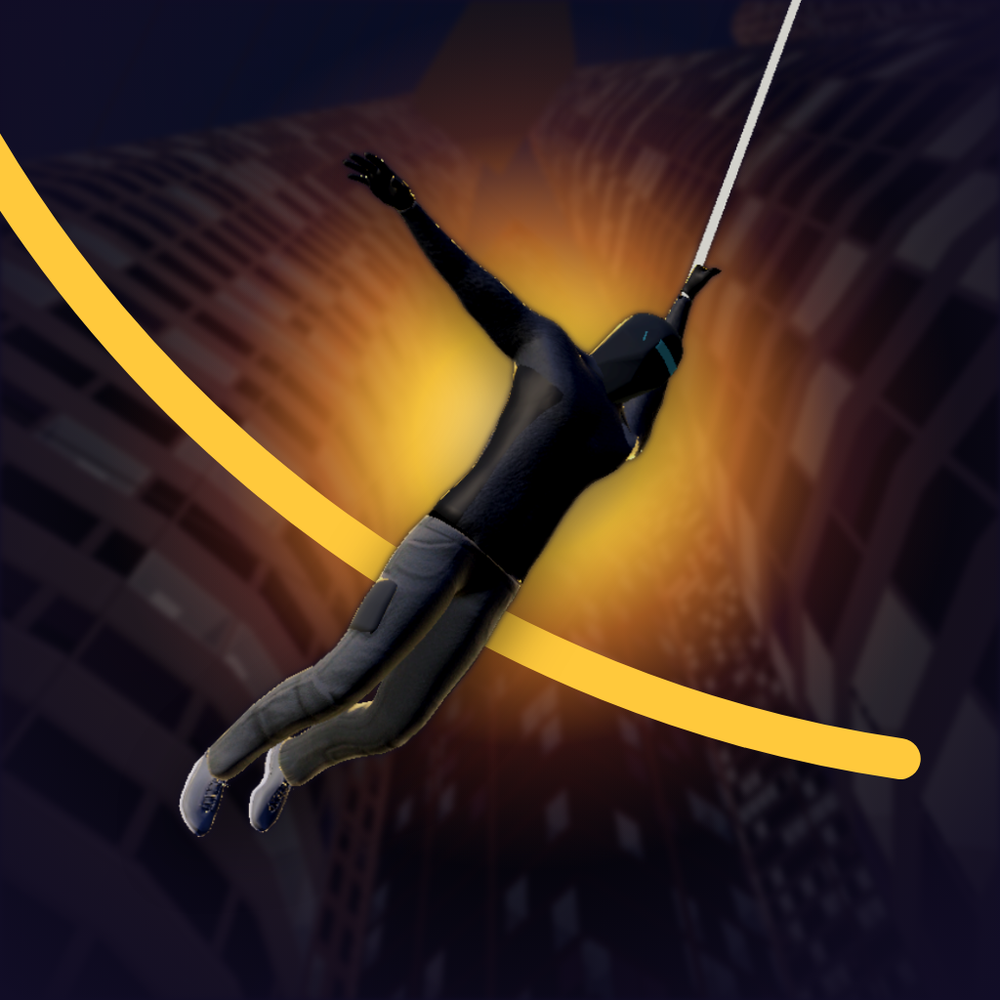

# City Swing

A skill-based, physics-driven city-swinging game for iPhone (landscape), built
with Godot 4.5 (Mobile renderer, GDScript) on a headless Linux VPS. No combat,
no story: the whole game is mastering momentum, timing and line choice.



## The swing model

`src/physics/swing_physics.gd` is a pure, deterministic model (no scene access):

- **Rope**: inextensible but can go slack. When taut, motion is integrated
  along the arc itself (rotation about the anchor), so the rope does no work:
  20 s of large swings drift < 0.15% in energy. A slack rope snapping tight is
  an inelastic jerk.
- **Gravity 19 m/s²** (tunable) so 40 m ropes swing at a readable pace;
  quadratic + linear drag bleed energy, so momentum has to be *earned*.
- **Reeling conserves angular momentum** (`r·v_t = const`), so reeling in
  through the bottom of the arc pumps energy into the swing, as on a playground
  swing. This is the core skill move.
- **Release never touches velocity.** You fly off with exactly what the swing
  gave you.
- **Limited control authority**: tangential "kick" on the rope (4.5 m/s²),
  horizontal air steering (5 m/s², which can't push you above 9 m/s by itself),
  ground running with momentum-preserving landings, wall-kick recovery.

`src/player/player.gd` feeds the model into a Jolt `CharacterBody3D` so
collisions against buildings are real; contact normals are fed back into the
model's velocity. The grapple line travels at 280 m/s (lead your shots), and
targeting (`grapple_targeting.gd`) fans 35 rays over real building collision
geometry, penalising walls that face you (they end a swing in a collision).

Every number lives in `config/swing_params.tres` (a `SwingParams` resource),
and the in-game **Pause → Tuning** panel edits them live on the device. See
[docs/TUNING.md](docs/TUNING.md).

## Controls

| | Touch (landscape) | Controller | Keyboard/mouse |
|---|---|---|---|
| Move / steer | left thumb, floating stick | left stick | WASD |
| Web | **tap and hold the building surface you want** (exact point under the finger); lift that finger to release; tap another building to re-attach | RT (assisted aim) | hold Space / LMB (assisted aim) |
| Look | drag empty sky, or the **LOOK** pad (never fires) | right stick | mouse |
| Jump / wall-kick / mid-air flip | **JUMP** | A | Shift |
| Pause | ⏸ | Start | Esc |

There are no reel buttons: a taut web tightens itself through the bottom of
each arc (angular-momentum pumping), so well-timed consecutive swings build
speed, and it winches to keep the arc off the street. Each finger keeps its
own role (stick, web, look), tracked by touch ID. Invalid taps (sky, street,
too far, blocked by another building) never fire; a red cross says why.

## Modes

- **Free Swing**: explore.
- **Time Trial**: three courses (Canyon Sprint, Three Graces, Beacon Loop).
  Courses are **recorded from real physics**: `tools/make_courses.gd` flies
  the expert autopilot along street routes and places wall-to-wall gates along
  the line it actually flew, so every course is provably flyable.
- **Endurance**: distance without touching the street or river (stalling on a
  roof for 4 s also ends the run).
- **Benchmark** (Settings → Run 45 s benchmark): fixed autopilot route,
  records frame-time statistics on the device.

Personal bests and lifetime stats are saved to `user://save.json`.

## The city

Generated deterministically (`src/world/city_layout.gd`), loosely after
Liverpool: the river to the west with a far shore; three waterfront landmarks
(twin clock towers with domes and gilded birds, a palazzo office block, a domed
port building); a glass business district peaking around a radio beacon in a
plaza; brick docks with basins and cranes; low Georgian terraces; a sandstone
cathedral; an elevated railway along the waterfront; CBD skybridges. About 680
buildings over 1.4 × 1.9 km, with an outskirts skyline beyond.

- Models (props, landmarks, viaduct, crane, character) are built by
  `tools/blender/build_kit.py` (Blender 4.5 Python, no manual modelling).
- Building massing is meshed in Godot (`building_mesher.gd`). Windows,
  mullions, shopfronts, brick and roofs come from `building.gdshader`, so detail
  costs no vertices.
- 200 m chunks are meshed on worker threads (~1.5 ms each), with a detailed and
  a low LOD switched by visibility ranges, MultiMesh props with short ranges,
  GPU-animated traffic, and per-chunk occluders (occlusion culling on).
  Collision for every building exists up front, so traversal never waits on
  streaming.
- Sound is synthesised by `tools/audio/gen_audio.py` (wind, rope hum, SFX,
  ambience, music).

## Workflow

```
tools/build.sh                # import + all tests + Linux export self-test + iOS Xcode project
tools/build.sh assets         # …regenerating Blender models and audio first
tools/build.sh courses        # …re-recording Time Trial courses (after physics/layout changes)
tools/build.sh shots          # …plus a rendered screenshot contact sheet
tools/filmstrip.sh <name> "2,4,6" --mode=free --bot=expert   # visual review under Xvfb
godot --headless --fixed-fps 60 -s res://tools/trace_bot.gd -- expert 30 canyon   # autopilot trace
```

Tests (`tests/`, 35 of them) cover the model analytically (pendulum period,
energy, angular momentum, slack/snap, release, drag, steering limits), the
real controller in Jolt (targeting, tunnelling, wall-kick, respawn, an expert
autopilot chaining 420 m vs a novice hitting the street), the generated city
(determinism, districts, overlaps, collision, streaming, a 590 m expert run),
and the modes (recorded courses, Endurance rules, save isolation).

## iOS

The VPS exports the Xcode project; building, signing and TestFlight need a
Mac. See **[docs/IOS_BUILD.md](docs/IOS_BUILD.md)**. Status and open items are
in **[docs/STATUS.md](docs/STATUS.md)**.

## Tool versions

Godot 4.5.1-stable (`~/opt/godot`, export templates in
`~/.local/share/godot/export_templates/4.5.1.stable`), Blender 4.5.3 LTS
(`~/opt/blender`), both symlinked in `~/.local/bin`.
