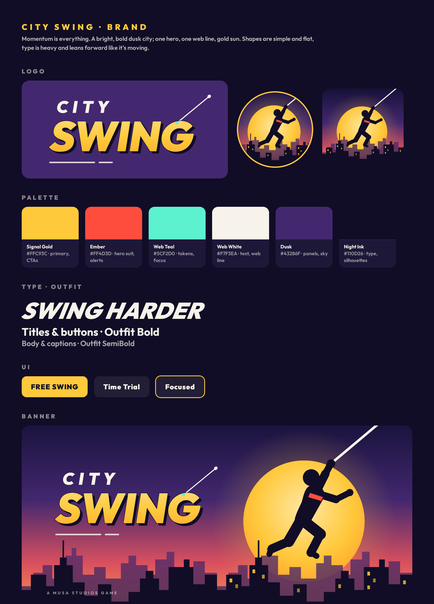

# City Swing brand

**Idea:** momentum is everything. A bold dusk city, one hero, one web line,
a gold sun. Shapes are flat and simple; type is heavy and leans forward as
if it's moving.

## Assets

Everything is generated from source – edit the source, then
`node tools/brand/render.mjs` (or `… render.mjs <name>` for one asset).

| Asset | File | Source | Used for |
|---|---|---|---|
| App icon | `assets/icon_1024.png`, `assets/icon.png` (copies of `assets/brand/icon_*.png`) | `tools/brand/icon.svg` | iOS / web icon |
| Mark | `assets/brand/mark.png` | `mark.svg` (icon scene in a gold-ringed roundel) | avatars, small placements |
| Wordmark, stacked | `assets/brand/wordmark_stacked.png` | `wordmark.js` + `wordmark_stacked.html` | menus, splash (`MenuParts.Logo`) |
| Wordmark, horizontal | `assets/brand/wordmark.png` | `wordmark.html` | store art, web |
| Splash / banner | `assets/brand/splash.png` (2340×1080) | `splash.html` | boot splash, store banner |
| Brand sheet | `docs/brand_sheet.png` | `sheet.html` | this page |

The hero, sun and skyline are drawn once, in `icon.svg`; the splash copies
them from there (re-render it after changing the icon).

## Logo

- **CITY** in Web White, wide-tracked; **SWING** in a Signal Gold gradient
  with a Night Ink outline and drop shadow. Both skewed −9° (forward lean).
- The web line runs from an anchor dot up and right of the word down to the
  top of the **G**, ending in a Web Teal grip dot. Two speed streaks sit under
  the stacked version.
- Keep the logo on dark or dusk backgrounds. Don't recolour SWING, drop the
  web line, or straighten the lean.

## Palette

| Name | Hex | Role |
|---|---|---|
| Signal Gold | `#FFC93C` | primary – calls to action, the logo, focus rings |
| Ember | `#FF4D3D` | the hero's suit, warnings |
| Web Teal | `#5CF2D0` | tokens, highlights, the web's grip |
| Web White | `#F7F3EA` | text, the web line |
| Dusk | `#43286F` | panels, sky |
| Night Ink | `#110D26` | text on gold, silhouettes, backgrounds |

In code: `UiStyle.GOLD / EMBER / TEAL / WEB / DUSK / INK`.

## Type

Outfit (OFL, `assets/fonts`): **Black** for titles and the logo, **Bold** for
buttons and card titles, **SemiBold** for body and captions.

## UI

- Primary action: a gold card with Night Ink text.
- Other cards: Night Ink glass (62 %) with a 1 px white hairline; Dusk on
  hover; a 3 px gold ring on focus.
- Pills (HUD chips, "TAP TO START"): fully rounded.
