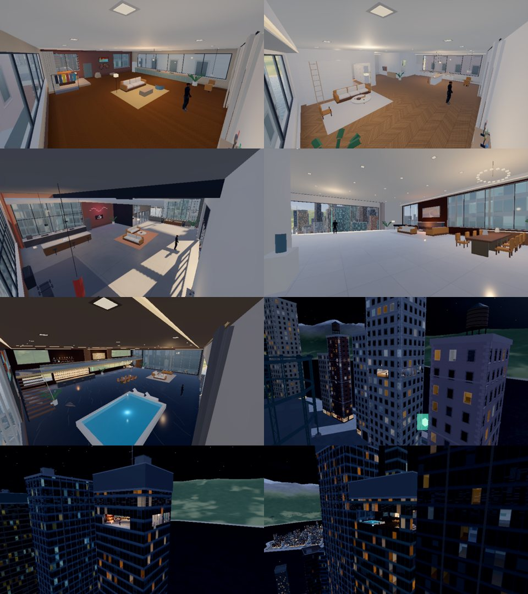

# Status: 2026-11-05 (1.0.0 release pass)

- **Version 1.0.0**, display name **CitySwing** (iOS keeps saves in the app's
  Documents folder whatever the name is). App Store pack: `store/APP_STORE.md`
  (metadata, reviewer notes, privacy label, age-rating answers), privacy page
  source `store/privacy-cityswing.html`, screenshots `store/screenshots/`
  (`tools/store_shots.sh` renders genuine captures at store sizes).
- **Sound v2:** `tools/audio/gen_audio.py` rebuilt as layered foley synthesis
  (transients, resonant noise, Karplus-Strong cable twang, bubbles, synthetic
  room/city reverb) – needs numpy + scipy. Still no samples, no licences.
  AudioDirector randomises pitch on repeated one-shots.
- **Speed flight pose:** `CharacterRig._speedfly` – flying fast (13→24 m/s) the
  wings fold: arms swept back, legs together and trailing with wind flutter,
  body pitched ~60° into the air; dives keep the arms back. pose_lab `fastfly`.
- **Homes:** Go/Visit from the in-game Homes menu left the touch controls hidden
  (fixed). Indoors (`Player.indoors`) walking is a capped 4.6 m/s jog with
  immediate turns and a quick stop.
- **Saves are atomic** (temp file → verify → .bak → rename) and recover from
  the backup if save.json is unreadable.
- Retaining walls: coursed stone in ground.gdshader (were flat grey slabs up
  to ~13 m tall). Free-roam tip moved to the lower centre (ran under the
  minimap). Release builds: perf overlay off, "Performance test" wording.
- Courses re-recorded for the shaped-building layout. Suite 159 + 2 known
  flakes (expert street touches, ledge_dive ankle).
- Not done on a device: no iPhone/iPad play-test or frame-rate measurement
  has been possible from the VPS.

# Status: 2026-11-03 (City Loop, coast, crashes, web reach, look)

- **City Loop replaces the edge railways.** The coastal Loop Line viaduct,
  the brick waterfront viaduct, the Valley shuttle and the dead-ended
  Cross-City Line are gone. One closed, one-way line (`RailNetwork`, line
  "city") runs north up the Spine through the CBD, west round the inner ring,
  down Dock Road, west along Valley Road and over its own **rail-only bridge**
  across the strait: a white steel through-arch (ribs take a web) to a turning
  loop on Westbank's quay (`RailNetwork.TERMINUS`, kept clear by
  `generate_mainland`), then back over the bridge and along Valley Road.
  Six stations (stairs via `CityInfrastructure.station_access`), three trains
  spaced through one timetable (`oneway`/`trains` in the line dict). Buildings
  in its path are cleared (`_clear_corridor`, 1 today). The island layout now
  generates Westbank itself (the line needs its ground); CityWorld reuses it.
- **Edges:** `CoastLife` – North Beach (the shore apron widens to ~88 m of
  sand between x 140–615: huts, steps, umbrellas/loungers, lifeguard towers,
  volleyball, a 150 m pleasure pier with a domed pavilion) and the Marina off
  the west quay (pontoons, fingers, piles, yachts whose masts take a web,
  motor boats, gangways, harbour hut). Kits with their own RNG.
- **Riding trains:** car collision is a hull of the drawn profile (curved roof)
  plus the roof pods (was a flat box 18 cm under the pods / floating at the
  edges); feet travel with the roof (`Gait.shift` from `Player.carry_velocity`);
  landing on a train keeps at most 4 m/s of relative speed, leaving it keeps
  the train's speed.
- **Crashes:** a knocked-out body now lies flat on the ground (ragdoll pin
  drops to lying height on the floor), `Player.slammed` → hit-stop beat,
  shake, thud, dust (`ImpactFx.slam/dust`), 1–2 bounces and a skid (humans
  only), limbs flung on impact. Cars and trains knock you out (`VehicleHits`,
  `Player.hit_by`; HUD "HIT BY A CAR/TRAIN"). Humans only.
- **Web reach from height:** `Player.reach_extra` (up to +50 m, humans only)
  from height above ground and fall speed; `p_eff()` carries it into
  targeting/attach/rope length; flatter fan rows (`LOW_ELEVATIONS`) while it
  is on. Web half-width 0.012.
- **Look:** richer blue sky, blue depth fog starting at 110 m (gradual, takes
  distant contrast), warmer sun, cooler shade, soft daytime bloom, a little
  more saturation and split toning. **Hills:** 45 m mesh, gullies/knolls in
  `Hinterland.height_at`, ~5k instanced conifers in clumps, canopy/strata
  detail and detail normals in hinterland.gdshader.
- Merged `improvement/world-cleanup` (bridge approach ramp, public spaces,
  station access, junction-clear piers, swing assist, touch/HUD fixes).
- Known: `test_skinned_body_follows_the_rig` fails intermittently on cold
  starts (394.2 mm) on the untouched pre-session commit too. `--cam` stills
  come out pink/dim (capture path), gameplay captures are correct.

# Status: 2026-11-02 (homes: 360° glass)

- **Every home is a whole floor of its tower, glass on all four sides.**
  The room is the storey's footprint inside 0.3 m outer walls; placement
  picks towers whose floor plate is the home's size (up to +4.5 m, the
  closest preferred): Studio 13×15 m, Apartment 16×16, Loft 22×17, Sky
  25×18, Penthouse 30×23. The front window is still the open one you swing
  through; the other three walls are glazed (`HomeInteriors.windows_for`):
  reveals, sill, frame, mullions, a pane. Solid bays only where tall things
  stand: the front door, a fireplace, the wine wall, the bar, wardrobes, the
  stairs. The facade is cut to match (`BuildingMesher.walls` takes several
  openings per face) and nothing is stuck on the home's storey outside.
  Collision is unchanged in kind: the glass is the 0.3 m wall.
- Furniture moved off the glass: the studio's kit rail is a free-standing
  divider and the bike hangs by the front door; the apartment's book wall is
  behind the sofa and the wardrobe on the hall wall; no wall cabinets over
  kitchens (windows instead); the loft's neon and board on the brick bay, a
  free-standing pull-up frame; the penthouse canvas above the stairs.
- From beyond 380 m (the room isn't drawn) the openings show dark glass.
- Placement also needs open air under the window (a neighbour's roof just
  below the sill was where swing-ins landed): the City Apartment moved to a
  113 m tower.
- Courses waterfront, uptown and grand tour re-recorded (tower collision).
  Camera probe routes take positions from the far walls (rooms vary in
  size now). 147/147.

# Status: 2026-11-02 (homes: things to use, trophies, finishes)

The homes are what you work towards, so they now hold your progress and
give you things to do:

- **Things to use** (`HomeSystem.near_spot`, HUD/touch prompt, F / pad B):
  - **Wardrobe** – the Wardrobe screen in your flat: the hero turns to face
    the room under a soft key light and an orbit camera frames what you're
    browsing (`WardrobeStudio`, the rooftop studio's controls).
  - **Sleep** – fade out, wake at the other end of the day (evening →
    morning, day → evening), rested.
  - **Job screen** (desk laptop / bar tablet / study) – the Job Board.
  - **Trophies** – the shelf close up with your stats beside it.
  Only in homes you own; a touch button appears bottom centre.
- **Trophy shelf** in every home (`HomeTrophies`): a medal on a stand for
  each Time Trial course (empty glass until earned), a cup that grows and
  changes metal with your contract rank, a jar that fills with tokens, a
  fold of each suit colour you've unlocked. Rebuilt when progress changes.
  The penthouse's is on the mezzanine by the Hall of Fame.
- **Visit before you buy** – Homes screen: "Visit" on homes you don't own
  (Free Swing). You can look round; nothing to use, no window re-entry.
- **Homes screen** shows a real render of each home and its floor size
  (`assets/ui/homes/*.jpg`).
- **Finishes**: plaster on plain walls and corner shading on walls and
  floors (no GI indoors: they read as stickers before); paintings (a
  painting shader, framed) instead of colour blocks; recessed downlights;
  lit ceiling coves in the apartment, sky apartment and penthouse;
  full-height curtains on a track. (A reflection probe per room was tried
  and dropped: the probe atlas took texture memory from 54 to 215 MB.)
- Cost, same views as before this pass (software Vulkan, counts only):
  studio 237 → 252 draw calls, 411k → 422k primitives; penthouse 325 →
  313 (the view moved with the bigger room); texture memory unchanged
  (54 MB). The trophy shelf is four batched meshes.
- **Night**: lamps come up at dusk (×2.6 at night, `home_lights.gd`) so the
  flat glows warm against the city instead of dimming with the sky; the
  sky apartment and penthouse gained a light by the glass (8 lights each,
  the Mobile renderer's per-mesh limit).
- Fix: the window wall's inner face is 0.3 m in (`WIN_Z`); things placed
  on it now sit on it, not inside it.
- Tests: `test_homes.test_things_to_use_at_home` (four spots per home,
  standing at each offers it, visiting offers nothing),
  `test_trophies_follow_progress`.

# Status: 2026-11-02 (homes pass: bigger rooms, indoor camera)

- **Bigger homes** (`Apartments.TIERS`, W×D×ceiling):
  Quay Studio 7.8×7.2×3.2 → 12×11×4.0 m, City Apartment 11×10×3.4 →
  16×14×4.2, High-Rise Loft 14×12×4.4 → 20×16×6.2, Sky Apartment
  18×14×4.2 → 24×18×5.2, Penthouse 24×18×5.2 → 26×20×7.2 (it now lives a
  storey under the roof of a 302 m tower; the city's towers are ≤ ~30 m
  wide, so 26 m is the widest that fits). Windows grew with them (4.2 →
  22 m wide). Spawn 1.7 → 2.2 m in from the glass.
- **Five layouts redrawn for the new sizes** (`HomeInteriors`): furniture
  to the walls and corners, the middle left open, door openings 2.9 m tall
  (`DOOR_H`) so the camera sees through them. Studio: sleeping platform
  behind a curtain, galley kitchen, desk at the window, bike, bistro table,
  front door with parcels. Apartment: bedroom, bathroom with walk-in
  shower, an entrance hall with the front door, a wall of books with a
  ladder, open kitchen + breakfast bar. Loft: 6 m ceiling, kitchen along the
  brick, glass-walled bedroom on a plinth (with a slope, not a snag), a
  training corner under neon, a record wall. Sky: lounge round the fire,
  piano, dining for eight, gallery entrance, master suite with tub.
  Penthouse: mezzanine at 3.4 m with the Hall of Fame and a study, bar and
  bed beneath, pool, lounge and dining. Sky finishes toned down (was
  glaring white); pendants hang ≥ 2.7 m away from tables so the lens
  never meets them at eye level.
- **Penthouse stairs** were 0.30 m blocks a slow walk-up snagged on; the
  treads are now visual over one walkable 36° slope (`HomeInteriors.ramp`).
- **Indoor camera** (`SwingCamera.indoor_ceiling`, set by `HomeSystem`):
  closer (3.5–4.2 m vs 4.8–6.2) and lower; collides with partitions and big
  furniture (human layer, ignored outdoors); crane limited and capped under
  the ceiling; keeps the hero's chest in sight round door frames; pinned
  close it looks past the hero into the room instead of down at them; the
  window look-down only applies while facing the window.
  Measured by `tools/home_cam_probe.gd` at 60 fps (walks every room,
  bedrooms, bathrooms, up the stairs and along the mezzanine), frames,
  old camera on the new rooms → new camera:

  | home | frames | lens outside the room | hero hidden |
  |---|---|---|---|
  | studio | 201 | 0 → 0 | 0 → 0 |
  | apartment | 353 | 6 → 0 | 25 → 1 |
  | loft | 268 | 0 → 0 | 0 → 0 |
  | sky | 276 | 0 → 0 | 67 → 0 |
  | penthouse | 594 | 0 → 0 | 32 → 0 |

- Fix: a 9.0 m/s window vault read as 8.9999 in float32 and fell back to the
  slow grab (`VAULT_MIN - 0.05`).
- Courses canyon, waterfront and spires re-recorded (the home towers'
  collision changed with the bigger rooms).
- Tests: `test_homes.test_indoor_camera_keeps_the_hero_in_view` (the
  probe's routes, real camera, ≤ 2% hidden frames, never outside, climbs
  the mezzanine); the mezzanine test checks the stair slope. 145/145.

Not done: the camera can still end up close behind the hero when you stop
facing a corner of a small room (it looks over the hero's head then); no
furniture you can sit on or use.

# Status: 2026-11-02 (character pass)

- **No hoodie.** Skin-tight compression tops cut from the MakeHuman body
  (so they fit and deform with the skin weights): Long Sleeve, Three-
  Quarter, Short Sleeve, Sleeveless (shop "top"; colour still "suit").
  Plane-cut hems (level waist, sleeves square to the arm), a knitted mock
  neck, contrast side panels, a heathered knit albedo and fine knit normal.
  Bare forearms/shoulders where the sleeves end. Cargo pants now end in a
  clean level waistband.
- **Faces** (shop "hero", free): Kai, Ade, Ren, Theo, Malik – MakeHuman
  facial targets (`art/hero/sources/face_targets`, CC0), head-only and
  normalised (shape, not size), each with eyes (iris tint), lashes, brows,
  lips and a buzz/crop cut from the scalp with a clean hairline. Skin, hair
  and eye colours are per face.
- **Masks** (shop "face", now "Masks"): Courier (the original signature,
  free), Runner gaiter, Domino, Balaclava, Respirator; shades, bandana and
  visor kept and re-fitted to the real head (CharacterRig.GEAR_FIT).
  Full masks hide the face (no draw calls under them); beanie/crown/
  balaclava hide the hair.
- **Running fixed**: the hips were dragged down every stride by a hip-drop
  term that measured to the swinging foot's current position (still behind
  on its way forward). Now vertical-only (kerbs, steps). Sprint: hip height
  0.78 → 0.88 m, stance knee flexion 67° → 34–41° (`tools/gait_probe.gd`).
- Drawn budget per outfit 41.8k triangles (was 43k); variants hidden.
- Old saves: `head_hood` falls back to No Hat (the hood is gone); new slots
  default (Kai, Long Sleeve).
- Tests: test_shop (variants, masks, skin tints), test_hero_asset (drawn
  budget, ≥15 hidden variants). 143/144: the failure is the known flaky
  ledge_dive get-up joint check.

Not done: `tools/blender/build_gear.py` no longer runs against the new
character script (it imported removed helpers); gear is fitted in-game.
No facial animation (blinks/expressions); hair is a short cut only.

# Status: 2026-11-02 (world pass)

- **Mountains round the bay** (`src/world/hinterland.gd`, `hinterland.gdshader`):
  one heightfield mesh (~16k triangles, underwater cells skipped), shaded
  by height/slope (sand, meadow, forest, rock, snow). Camera far plane
  2400 → 6500 m (reversed-Z, no depth cost). Backdrop only: no collision.
- **Power lines** (`power_lines.gd`): lattice pylons (MultiMesh) along the
  foothills and up to a pass, catenary conductors in one mesh.
- **Westbank** has its own coast landforms (`CityRoads.landform`): bays, a
  cape, an inlet; 554 → 456 buildings.
- **Cross-City Line** (`RailNetwork.build_cross`): elevated two-track
  metro down the Spine boulevard, coast to coast through the CBD, deck 16 m
  over the road, flyover over the Valley Line, four stations, two trains
  calling at every station. The viaduct is solid but takes no web (world
  layer only, `CityLayout.kit_solid_only`); grapple targeting now treats
  such bodies as occluders (it used to pick anchors behind them).
- **Stadium**: superellipse bowl (two tiers, concourse, back wall), ring
  roof with a lamp band, four 80 m cable-stayed masts (anchors), fins, a
  big screen, kiosks; site 96×82 → 150×130 m, moved 24 m west off the ring
  road.
- **Buildings**: new "tapered" (ziggurat) form; wider palettes (painted
  terraces in Old Town, London stock / engineering brick, bronze and green
  glass, terracotta / charcoal modern, jade / salmon deco); roof crowns on
  supertall towers (spire, helipad, louvred plant crown + mast) and roof
  gardens on some mid-rise blocks, kept to the edges.
- **Roof edges**: airborne mantle onto ledges whose top is within 2 m of
  the feet; deco/stone mid-edge roof piers lowered from ~2.6–4 m to 1.1 m
  (they stood where you land).
- Courses re-recorded on the new city (8/8 first try). Token spots are
  derived from the buildings, so their positions moved; collected counts
  are kept (ids), but a returning player's collected set maps to new spots.
- Tests: `tests/test_world_pass.gd`; `test_trains` now expects five trains
  and checks a Cross-City train calls at every station; the street-launch
  test stands by the Spine's kerb (12 m out) instead of under the viaduct.

Not done: facade window-grid repetition (shader work), mainland
architecture beyond its outline, drones still don't avoid the new viaduct.

# Status: 2026-11-01 (transformation pass: contracts, homes, light)

Branch `feature/cityswing-transformation`. QA report and images:
`docs/qa/TRANSFORMATION.md`.

## What changed

- **Contracts** (new gameplay loop, `src/core/contracts.gd` rules +
  `src/modes/job_board.gd` in Free Swing): legal (Rooftop Delivery,
  Express Courier, Gondola Rescue, Skyline Survey) and underworld (Hot
  Drop, Getaway, Rooftop Heist) jobs, found as beacons on rooftops and
  taken by landing there. Underworld pays ~2.4x and brings pursuit drones
  (heat while seen, busted = 35% fine). Reputation ranks open tiers 1-5.
  Job Board in pause, HUD card (clock, heat), beacon labels (max 3, fade at
  swing speed), minimap icons, toast, results chip, first-session hint.
- **Homes**: five distinct interiors instead of one recoloured plan (see
  `home_interiors.gd` header); progress board on the wall (Hall of Fame in
  the penthouse); penthouse mezzanine is walkable; "rested" coin
  multiplier for starting at / climbing into a home (x1 .. x3).
- **Bug fix: homes had no view.** Occlusion culling used each tower's full
  box as an occluder, so the camera inside a home was inside its own
  occluder and the whole city was culled (you saw the sea plane with cars
  floating on it). Home towers' occluders now stop below the room.
- **Lighting**: less flat ambient, sky-tinted shade, stronger sun, haze
  pushed back (day fog from 220 m at 0.46 density), firmer grade.

## Measured (VPS, software Vulkan: counts only, no device timing)

| view | main | branch |
|---|---|---|
| free swing seed 4, 3 frames, HUD | 167-274 dc, 306-400k prims | 180-298 dc, 310-395k prims |
| same, HUD hidden (3D only) | 201 dc, 364k | 207 dc, 365k |
| penthouse interior | 170 dc, 185k | 307 dc, 302k |
| street view (q2) | 199 dc, 674k | 199 dc, 679k |
| endurance seed 4 (homes, no jobs) | 208-226 dc | 212-226 dc |

The beacons cost ~6 draw calls; the interiors cost nothing measurable
away from a home and ~+135 draw calls inside the penthouse (the most
furnished room: glow/glass/feature planes, furniture GLBs). Interior
pieces don't cast sun shadows. Not measured on an iPhone/iPad.

## Not done / next

- Swinging, camera and character were not retuned: the model is covered
  by ~60 tests and the Courier was being worked on by another agent; any
  feel change needs a device.
- City architecture (window-grid repetition, silhouettes, district
  identity) was not reworked in this pass beyond lighting.
- Drones fly through thin geometry when cutting corners close to you
  (they route round towers using a 20 m roof-height grid).
- Interiors are procedural boxes/tubes plus the existing Blender furniture;
  no new Blender assets (no Blender in this container).
- Pre-existing: test_course_uptown_flyable and
  test_course_switchback_flyable fail in this container on main too.

# Status: 2026-11-01 (premium redesign, v0.14.0)

## Redesign pass (latest)

Visual QA report and images: `docs/qa/VISUAL_QA.md`.

- **Minimap** (`src/ui/minimap.gd`, `src/ui/shaders/minimap.gdshader`): replaces the TOKENS banner and the km/swings line. Baked once at startup by a one-shot SubViewport 2-D render of the real layout (island and mainland coasts, road surface, blocks, parks, plazas, set pieces, basins, every footprint shaded by height, rail, bridge and approach) at 1.5 m/px RGB8, about 6 MB with mipmaps. Drawn as one shader quad: a soft disc that rotates with the camera, with zoom easing from 95 to 175 m with speed. Overlay: hero arrow, north tick, at most 5 markers by priority (next goal pinned to the rim). Free Swing feeds tokens; Time Trial feeds the next three rings. The mode readout (trial clock, endurance) sits compactly under the map. Token totals moved to the pause menu, stats and results. Tests: `tests/test_minimap.gd`.
- **Cinematic title** (`src/camera/cinematic_director.gd`): five shots (golden hour, canyon, skyline, momentum, rooftops). Each sets its time of day, starts the ShowcasePilot on a chosen avenue leg, and drives `SwingCamera.cine`: the offset from the hero is smoothed (not the absolute position), the open side of the street is picked per cut, and the lens shift puts the hero about 22% left of centre, clear of the menu. Slow motion is eased in canyon and momentum. Cuts dip through Night Ink. `--cine=N` starts on shot N (captures). Leaving the title restores the clock, weather and time scale.
- **Menu** (`menus._show_main`, `_menu_row`, `_menu_column`, `_brand`): a minimal right-aligned column at top-right, a small wordmark bottom-left, `MenuParts.edge_shade` instead of the dark left panel. Every action and test ID is kept (free/trial/endurance/training/shop/shop_card/stats/settings). `_safe_rect()` only applies the screen-space safe area to full-screen windows (on windowed desktop it pushed the column off-screen).
- **Wardrobe shop** (`menus.show_shop`, `src/ui/thumb_studio.gd`):
  - Left side: category sidebar, a grid of real-render thumbnails (isolated studio SubViewport with a CharacterRig, one item per frame, cached for the session; webs show a line in their colour), and a detail bar with one action (Wear / Buy → Confirm / unlock requirement).
  - Right side: the hero, live, on a real rooftop (director `enter_shop`: the nearest 55–110 m rooftop spawn to the CBD, facing the open side, 16.9 h light, idle actions off), framed per category. Drag to orbit, pinch/wheel to zoom, double-click or the View button to reset.
  - Selecting only previews; leaving restores the equipped look.
- **Landing**: off-balance catch (`CharacterRig.stumble_t`) when landing moving sideways to the body or out of a banked air turn: arms out, torso tips and rights itself, and the gait takes the steps. Test: `test_sideways_landing_stumbles`.
- **Consistency**: page headings are now 34 px white; the gold primary card, glass cards and chips are shared across pause, results, stats, settings and shop.

Measured (VPS, software Vulkan, `--mode=free --seed=4 --stats`, same frame): draw calls 191 → 198, primitives 337.5k → 337.9k, texture memory 42.1 → 49.2 MB (the minimap), static memory 339.6 → 341.4 MB. Tests: 114/114. No device FPS measurements.

Not done:
- Hood and sleeve twist (no cloth bones).
- Ragdoll and get-up transitions are unchanged.
- No world/terrain changes in this pass.
- Hats/face glyphs are coloured drawings, not mono icons.
- The ledge_dive get-up joint check is still intermittent (pre-existing: it failed 1 of 3 runs on the code without the stumble too).

# Status: 2026-11-01 (character realism pass, v0.13.0)

## Character pass (latest)

Brief: make the hero a believable urban athlete in a hoodie, joggers and trainers, with clothing that moves, natural idle life and better body mechanics. Before/after: `docs/character_before_after.png`.

- **Model** (`tools/blender/build_character.py`, same bones/joints/palette keys, so shop recolours and gear still work):
  - Pullover hoodie: relaxed body bloused over a ribbed hem that covers the hips, dropped shoulders, roomy sleeves bunching above ribbed cuffs (the left cuff pushed up), kangaroo pocket with stitched outline and slits, side seams, soft fold ridges (blouse, armpit drag, small of back, inner elbows).
  - Roomy jersey hood (1.6 cm thick, lining round the opening, centre-back seam, drooping peak, loose folds) plus a neck cowl. Drawcords with aglets (left longer) replace the back spool on the chest part.
  - Joggers: knee bag, rear-knee creases, gathered bunching cuffs, a quiet side seam (the accent stripe, knee pads, belt, emblem and raglan panels are gone).
  - Layered trainers: knit upper, padded collar, tongue, white midsole, dark outsole, accent heel counter/eyestay/tab, flat laces, and a loose loop on the left.
  - Blended colour-transfer corners are snapped to the nearest palette key (they used to escape shop recolours).
- **Cloth motion**: per-vertex cloth weight in UV2 (hem, lower back, sleeves toward the cuffs, lower legs, hood back/peak, cord ends). `CharacterRig._update_cloth` runs one underdamped spring per character: air (wind − velocity; the wind grows with height and gusts), inertia, gravity when inverted, and kicks on landing. `character.gdshader` offsets the vertices, never inward (the inward part is flattened) and adds an outward-biased flutter at speed. Cost: one spring on the CPU plus a few ALU per weighted vertex.
- **Idle life** (`_idle_pose`): exertion-driven breathing, weight shifts at random intervals, gaze targets that hold, and random idle actions (glance back, shoulder roll, shake-out, gauntlet check with a cuff tug, neck stretch, look down). Winded after hard running: bent over, arms loose, deeper breathing, then recovery. At a roof edge the hero sits back and looks down at the drop; high up, a lean into the wind. Review with pose_lab `idlelife`, `edge`, `winded`, `idleacts` (`CharacterRig.play_idle`).
- **Swing/air**: the free hand reaches toward the real next pick (`targeting.pick`) on the upswing, and between webs the web arm comes up toward the next anchor (anticipation, `_reach_next`).
- **Run**: less high-knee and less sink (swing-foot lift 0.30→0.26 m, pelvis crouch reduced). In the motion audit at sprint, pops fell slightly in most locomotion scenarios and float was unchanged.
- New rig state is reset in `_on_respawned` (it leaked between motion-audit scenarios and broke run_into_wall).
- Tests: test_character `test_clothing_trails_motion_and_settles` and `test_idle_has_life`. 111/111 pass.
- Cost: character drawn triangles 21.7k → 24.1k (hood +1k, trainers +0.6k each, cords +0.2k). Body still 9,000. No new draw calls or bones.

Not done:
- No cloth bones. The hood doesn't turn independently of the head, and the sleeves don't twist.
- Landing variants and ragdoll were left as they were (soft/roll/three-point already existed; no "awkward landing" correction yet).
- The face is still the masked head with glowing lenses (the user asked earlier for an always-covered face).

# Status: 2026-11-01 (quality & polish overhaul)

## Polish pass (latest)

Brief: game-wide quality overhaul. Baseline: 108/108 tests; render stats + bot filmstrip + camera probe captured first.

- **Camera**: slides sideways away from a facade within 3.4 m (`SwingCamera._side_offset`, continuous push, smoothed). New `crowd` metric in `tools/camera_probe.gd` (% of frames where a wall within 2.5 m fills a side of the view): mean over seeds 2–9 went 4.9 % → 3.0 %. Jerk/pops are noisy run to run (runs aren't deterministic); a small rise in angular jerk is possible.
- **Shopfronts**: `shop_room()` interior mapping in building.gdshader: lit shop interiors (shelves of goods, cafés with counter/menu board, boutiques with garment rails), glazed doors, dark plate glass with reflections. They used to read as flat brown boards. Shader only.
- **Roofs**: `BuildingMesher.roof_top` packs roof half-extents in UV2.x (negative) and measures UV from the roof centre, so the shader draws parapet grime, flashing, drains and stains, and gravel only up close (fwidth-gated). Pale finishes are toned down. Glass-crown decks (the roof you land on) now get the roof finish instead of the trim colour.
- **Shadow acne**: sun `shadow_bias` 0.04 → 0.1 removes the moiré bands on flat roofs at mid distance.
- **Close calls** (`src/player/near_miss.gd`): skimming a facade within 3 m at ≥ 58 km/h while airborne, travelling along it (not into it), with no bump/stagger/KO pays coins × multiplier plus 25 m of multiplier progress (double for a "razor" pass < 1.3 m). Comes with a HUD callout, a whoosh + haptic, and a results tile. 2 rays per tick. About 1 per 40 s for the expert bot. Covered by test_swing_scene.test_close_call_past_a_facade.
- **Footsteps** now fire on the gait's real touchdowns (`CharacterRig.footstep`), not on a distance timer. Sprint steps land harder.
- **Bridge traffic**: 4 lanes over the suspension bridge + approach viaduct (heights from `approach_y`). Connectors keep the deck height. `_near` won't join an elevated lane to a ground lane. The island end runs into a new tunnel portal in the east anchorage (the deck used to dead-end at a blank wall); cars turn round out of sight inside it.
- Traffic: cars parked short of the line after their leader turned off now creep up (was a frozen-car source).
- CBD radio tower model: rings, glazed band, aviation lights (rebuilt beacon.glb only).
- `tools/render_stats.sh` street/cross views re-picked (the old street view was underwater on the island map).

Performance (render_stats q2, software Vulkan, so compare only): swing 150→141 draw calls, 436k→437k prims; aerial 171→180 dc, 250k→251k prims; street/cross (new views) unchanged before/after the shader work. Shader cost grows only on shop and roof pixels at close range.

Remaining / not done:
- **Traffic gridlock (pre-existing)**: after 4 simulated minutes about 290 of 952 cars have been still for > 30 s, mostly queues at roundabout entries (`tools/traffic_audit.gd -- 240`). A forced-merge breaker was tried and dropped (more overlaps). Needs a proper junction/roundabout yield model.
- The bridge has no road down onto the island (the portal hides that).
- Character animation was reviewed in pose_lab (run, swing, landing, knockout, get-up) and not changed.
- No device testing still; touch feel and FPS on iPhone unverified.

# Status: 2026-10-31 (organic road network)

## Road network (latest)

User: "the whole map is grid like, not realistic" → chose a fully organic street network.

**Plan** (`src/world/city_roads.gd`, `CityRoads`): organic island outline (noisy rounded coast, straight strait quay in the west with a 40 m promenade for the viaduct and bridge anchorage), coastal ring road, named boulevards from smoothed control points – `diagonal` (bridge → CBD → past the cathedral), `spine` (north–south S), `valley` (along the railway), `heights`, `crescent` (Old Town), `inner` (closed ring round the CBD) – roundabouts where they cross (green islands), then every region carved into blocks by recursive street cuts styled per district (skewed grid CBD, angled midtown, quay-straight docks, winding small-block Old Town). Cuts end at the streets they meet (T-junctions) and avoid reserved footprints (landmarks, set pieces, beacon plaza, ship basin). `tools/roads_view.gd` previews it top-down.

**Road field** (`CityRoads.bake_field`, 2 m texels, worker pool): nearest road's signed offset, ±half width (− = boulevard), distance along (mod 64), distance to the nearest other road's kerb (< 0 in junctions). ground.gdshader draws all paint from it (curving centre lines, boulevard lane dividers, zebras/stop lines at every junction mouth, drains, manholes, kerbs, paving); CPU `field_at` / `on_road` for placement and tests.

**Terrain**: the landform is sampled on a regular 8 m grid (`CityTerrain.build(area)`), no longer at street junctions. `poly_level` for terraces.

**Blocks** (`CityLayout.blocks`: dicts with poly, holes, district, kind block/plaza/park/piece/basin/esplanade, rot, pivot, level, basin): `block_at` (grid-indexed polygon lookup) → `ground_y`. The esplanade round the coast is one raised pavement with the ring road's kerb as its hole.

**Buildings face their streets**: lots are laid along every frontage of a block (district lot sizes in `LOTS`), each in its own frame (`b["rot"]`, `b["pivot"]`; `CityLayout.bxf`), plus a courtyard tower where it fits. All layout code still works in axis-aligned local coordinates; `_to_world` turns what a lot/block generated into the world. The mesher applies the frame to every quad (`BuildingMesher._begin/_end`), collision uses oriented boxes (`CityWorld._add_box_xf`), and everything that asked "is this inside a building" uses `CityLayout.inside / top_center / base_center / tier_aabb`. Sky bridges/sky lobbies join any two tall neighbours 26–62 m apart if the tube is clear (`_skybridges`; the avenue-only "gateways" are gone).

**Ground** (`BuildingMesher.add_ground`, built once per chunk on the worker pool at startup and reused for drawing = collision): the road surface over the land (Delaunay over grid + boundary points, clipped to the coast minus basins), every block's slab (sloping + kerb or level terrace), kerbs/retaining walls, basin quay walls, sea walls and the shore apron along the polygon coast.

**Measured (VPS)**: 98/98 tests; all 8 courses re-recorded on the new roads (Grand Tour needed a 2nd try); spawn audit 0/24 knockouts (2/24 first swings touch the street); collision audit: ghost 225 (roof huts/crane jibs, was 301), over 7 (crane jibs), sink 17 (the el's rails, drawn without collision), 29 wall flags (container-yard kit + a few ground spots at Valley Road's east end – not chased), 1 "hole" = open sea. Startup layout+collision ≈ 1.9 s (was 0.85 s on the grid: road field 0.4 s, ground built on the worker pool). Not measured on a device.

**Tests changed with the plan** (not loosened to pass): overlap test works on world footprint quads and checks nothing stands on a carriageway; the street-map test became a road-field test; street-launch spots on the spine skip roundabouts' open circles; the roof-run test runs across the roof (the spawn heading points off the edge, at the swing route). Fixed on the way: tokens weren't placed (inside() margin applied above roofs), the test bot shuttled (goal flipped with swing velocity – it now keeps its road and direction), spawn headings no longer face a roof prop.

**Everything else on the new plan**: traffic lanes from road polylines (simplified segments, 2 lanes, 4 on boulevards), traffic lights where side streets meet their road, parked cars along minor streets, walkers round every block, street lights/trees and furniture along simplified block edges, elevated railway following Valley Road (deck segments, bents on the kerbs clear of junctions, train along the curve), set pieces at fixed rects (`SetPieces.rects()`; gasholder moved to (800, −555)), courses rebuilt on named roads (`CourseBuilder.route`), title autopilot loops the Inner Ring, the test bot follows boulevards (`CityWorld.bot_goal`, keeps its road and direction).

# Earlier 2026-10-31 (island city, every district swingable)

## Island + map pass (latest)

User: "turn it into an island so there's not just empty open space … other parts of the map the buildings aren't tall enough to swing … more different size, different shaped buildings, personality … the business place is the best place to swing, I don't want to go anywhere else" + wind streaks lower opacity.

**Island** (`CityLayout.island`, `_island()`, `_sea()`): the low filler blocks that ran 760 m past the city on three sides are gone; the city is an island. Sea on the north, east and south (`CityLayout.sea`, also in `water`, so falling in splashes/respawns); the strait (old river) and the suspension bridge to the mainland stay in the west. One more avenue was added past the last block column (no random draw), so the eastern blocks and the cathedral are whole. Past the outermost streets an 18 m esplanade runs to a sea wall with a stone railing (`BuildingMesher._coast`, drawn = collision).
- **Shoreline** (`BuildingMesher.shore_samples/shore_profile/_shore`, `KIND_SHORE` shaded in ground.gdshader): an apron round the perimeter (wrapping the corners): layered rock headlands and coves where the land is high (the Heights meet the sea in 25–35 m cliffs on the east), sand beaches under the sea wall where it's low; the docks keep a plain quay. Ragged outline from 1-D noise, jagged facets, bedding-plane rock shading, wet line. Collides (same triangles).

**Heights** (`_height_for`): every district is now swingable. Share of roof area ≥ 45 m above its street (new `test_every_district_is_swingable`): waterfront 95%, Old Town 92%, midtown 98%, docks 81%, CBD 94% (before, by map raycast: Old Town ~21%, docks ~30% of built area). Old Town = mansion blocks 36–60 m with 62–155 m towers; docks = warehouses + loft/residential towers to 150 m; waterfront 52–175 m. Fewer parks in Old Town/midtown.

**Shapes** (`_form_for`, own seeded stream per building): pencil towers, slabs, twin towers on a podium with a sky bridge, cantilevers (top block hanging out over a recessed body; undersides drawn via `BuildingMesher._overhangs`), offset setbacks stepped to one side, stepped deco crowns, Old Town campaniles (bell/clock tower off a roof corner + spire), dock grain-silo rows with headhouse and gallery (`_silos`). Mixed per district so each has its own skyline. Roof props avoid towers (`_roof_furniture(..., blocked)`); roofs with towers aren't spawns (`roof_blocked`).

**Bug found + fixed**: the first cut used `Array.shuffle()` (global RNG) → the city differed every launch. Now seeded; `test_whole_layout_repeats_exactly` compares two full generations.

**Measured**: spawn audit 0/24 knockouts; collision audit vs previous commit: over 549 → 8, sink 234 → 0 (old outskirts), ghost 273 → 301 (roof huts/crane jibs, known category), 2 new minor wall flags at the north street edge. `tools/map_view.gd` = top-down height map + per-district stats. Render stats at the fixed views not worse (fixed cameras aren't height-matched to the new ground, so not a like-for-like saving). Not measured on a device.

**Tests**: 96/98. Courses re-recorded (8/8). Open: `test_spawn_and_reattach_transitions_are_smooth` – seed 9's roof gives a 1.9–2.3 m camera pop (seeds 10–13: 0.2–0.4 m), a real pop beside a new tall neighbour, not yet fixed; `test_swing_launches_cleanly…` – 6/8 (two rooftop launches catch a web and rise 14–23 m but travel 13–15 m against a 15 m bar).

**Wind streaks**: peak opacity 0.22 → 0.09 (`SpeedTrail.ALPHA`), gold flash on a perfect release kept.

# Earlier 2026-10-31 (terrain: a city with geography)

## Terrain overhaul (latest)

**Why it was flat** (audit): every layer assumed y = 0 – `add_ground` drew streets as one quad at 0 and blocks as slabs at 0.15; street collision was flat boxes (−2..0) and pavement boxes; every building tier, prop, crane and set piece was generated from 0; the GPU traffic/pedestrian shaders slid along flat lanes; gameplay used absolute heights for "street level" (camera, audio, title pilot, course gates, tokens).

**Geography** (`src/world/city_terrain.gd`, designed, not noise): river, waterfront and docks at quay level 0 (river wall, basins, ship, bridge landing unchanged); land rising east from the waterfront; the CBD on a raised plateau (+22 m); the Heights, a north-east ridge round the cathedral (+47 m); a rail valley running east from the docks along the elevated railway (0 m). The landform is sampled once per junction; streets run at a constant grade between junctions (bilinear road surface, ≤ 15% on the Heights' west flank, 7–11% plateau ↔ valley); beyond the grid it continues level (outskirts, far shore).

**How things stand on it**
- Pavements follow their street (constant 15 cm kerb). Each building stands level on its own lot at the lot's highest street corner, with a dressed-stone base course down the slope (`b["base"]`, `b["foot"]`, `BuildingMesher.base_course`). Facade bands (shopfronts, ledges, plinth, awnings, fire escapes, portals) are measured from `base`.
- Set-piece blocks and dock basins sit on level terraces with retaining walls (`CityLayout.terraces`). Construction sites lift rigidly with their crane.
- Layout generation is unchanged at street level 0; `CityLayout._lift` / `_lift_on_slope` lift what each block added (buildings, props, structures via `y0`, set-piece collision, anchors, landmark models). Roof props rise with the building they stand on.
- `CityLayout.ground_y(x, z)` = what you'd stand on; `Player.height_above_ground()` replaces absolute heights in the camera, audio, title pilot and course gates; tokens and spawns measure from the ground.

**Ground and collision**: streets and pavements are tessellated through every junction line (16 m inside the grid; exact and coarse outside it). Ground collision is a trimesh per chunk built from exactly the triangles drawn (plus outskirts). Collision audit: no holes, no float/sink, 1 wall flag (a stadium edge).

**Traffic and pedestrians** ride the terrain on the GPU: global shader uniforms `ground_height` (RG texture, 2 m texels: R = north-south traffic incl. decks, G = ground) and `ground_rect`; cars pitch with the grade. Parked cars and furniture are placed on the ground by the CPU.

**Multi-level**: the Valley Causeway carries the avenue at x ≈ 715 across the rail valley on a road deck (street level at both rim junctions, ~6 m over the valley floor), with traffic on the deck, the valley streets passing under it and the elevated railway (14 m) over it – a three-level crossing. Parapets are web anchors.

**Measured (VPS, Xvfb)**: like-for-like views (cameras at the same height above ground) +7–20% primitives vs the flat city (aerial 185k → 222k, street 417k → 477k); startup layout+collision ≈ 0.84 s. All 8 courses re-recorded; 95/95 tests. Not measured on an iPhone.

**Honest limits**: the relief (0–47 m) reads clearly at street level (streets climbing to the Heights, cresting off the plateau, the causeway underpass) but only weakly from rooftops and the air, where 50–300 m towers dominate. Before/after pairs: `screenshots/work/ba/` (git-ignored).

## Polish pass 2 (2026-10-31)

- **Geometry cost fixed**: the art pass's features had raised per-frame primitives 50–130% (aerial view 188k → 433k). Features now live in their own per-chunk `Features` mesh drawn to 190 m (`CityWorld.feature_range`), fins are 3 quads, fire escapes lost mid-rails/rungs: back to 417k street / 185k aerial (pre-art-pass levels).
- **Ghost collision fixed**: outskirt and far-shore blocks got feature collision without drawing features; they now opt out (`BuildingMesher.NO_FEATURES`). Billboard legs and catwalks collide (collision audit "over" 31 → 4, all crane cables).
- Glass towers over 100 m: 70% get a glass crown screen (4–7 m, light coping) drawn at every LOD; glass coatings dominate their sky reflection (champagne/bronze/silver/teal/green/blue), so the CBD is no longer one blue.
- Web line: catch twang, thins and brightens under swing load, thicker at the hand.
- Camera: flight distance 5.0–6.6 m (+≤1.3 for long ropes; was 5.4–8.0 +≤2.2), max FOV 82°. `tools/camera_probe.gd` (`--camaudit=<s>` with `--bot=expert`): angular jerk, pops, hero screen jitter and size.
- Known flake: test_motion_quality ledge_dive get-up ankle fails ~1 in 3 runs on identical code (nondeterministic), seen on this tree; not caused by these changes (the test stage doesn't use them).

## Art-direction pass

- **Lighting** (`atmosphere.gd`): warmer, stronger sun (2.3) against a cool blue sky fill (ambient 0.62), so lit and shaded faces finally contrast; deeper blue zenith, cleaner horizon. Fog is now depth fog (clear to 180 m, soft blue veil to 2.6 km) instead of an exponential grey wash over everything. A procedural 17³ grade LUT (`Atmosphere.grade`): gentle S-curve, cool shadows, warm highlights, mid saturation.
- **Fixed a long-standing shader bug**: the facade shader compared an interpolated surface kind with `==`, so parts of every roof and cornice ran the window code: that was the "gravel" grain and streaks on roofs. `v_kind` is now a `flat` varying.
- **Facades** (`building.gdshader`): recessed windows whose reveals cast the sun's shadow on the correct side (`sun_dir` uniform from `Atmosphere.sun_direction()`), stone sills (+ brick lintels), stone quoins on masonry corners and a fine shaded arris on every corner (walls now pass face position/width in UV2, see `BuildingMesher._face_span`; the per-building seed is snapped to 1/256 so interpolation can't scramble window hashes), calmer glass (fewer beige blinds and daytime-lit windows), darker shopfronts, ground contact shading and a facade height gradient. Roofs get soft weathering patches and paver walkways.
- **Architecture** (`BuildingMesher.features(b)`, cached in the building dict, drawn in the detailed LOD and collided via `collision_boxes`): iron fire escapes on brick/warehouse blocks (platforms at window-sill height over two window columns, zig-zag stairs, drop ladder; collision = the escape's volume plus the top platform's railing), classical entrance portals with lamps on masonry and steel-and-glass canopies on modern/glass towers (on a shop-bay centre; awnings skip them), vertical fins on ~60% of glass towers (collision 0.24 m proud), chimney stacks on brick/sandstone roofs, crowns of piers on tall deco/stone towers. Collision audit: no new hole/float/wall flags.
- **Hero**: the character shader takes the sRGB-authored palette to linear (^2): the suit is deep crimson instead of salmon, trousers true navy; a two-tone rim (warm sun side, cool sky side) keeps the silhouette readable on any facade.
- **Speed trail** (`src/player/speed_trail.gd`): thin wind ribbons off the feet above ~60 km/h tracing the swing arc; they flash gold and widen on a perfect release.
- **HUD**: one panel language: `UiStyle.pill` draws slanted Night Ink tags with a hairline edge (near-black panels are mapped to Night Ink); Swing/Jump/pause/stick are Night Ink glass with hairline rings, gold only for "a web will land" (ring, brackets, label), filled gold while held. No more big yellow disc.
- **Autopilot / courses**: `SwingBot` gets stuck recovery (grounded and not displaced 2 m for 1.5 s with nothing to web: one hop, then turn back off the ledge), measured by displacement since a body pinned on a wall still reports speed. `make_courses.gd` retries a DNF up to 6× from a start nudged a few cm (the exact start is stored, replays stay exact). All 8 courses re-recorded against the new architecture.
- Cost: startup layout+collision ≈ 1.0 s on the VPS (was ≈ 0.75 s; ~1.3k more collision boxes). Not measured on a device.

# Status: 2026-10-30 (map set pieces, exact collision, mask, wall reactions)

## Map, collision and contact pass

- **Collision = what's drawn.** `BuildingMesher.collision_boxes(b)` builds every building's collision from the same numbers the mesher draws with: walls, the cornice/roof slab (roofs used to float 30 cm above glass roofs, and feet sank into masonry ones), parapet ring (now 0.3 m, under STEP_MAX, so a run steps onto it), plinth band, shop awnings (solid: you can land on them), construction frames with columns, hoarding and edge barrier. Ledges stand 8 cm proud (visual only). Roof props sit on the drawn roof (`BuildingMesher.roof_y`).
- **No more falling through the ground**: the street collision now covers all the drawn ground (city, outskirts to +1 km, far shore). Previously it stopped ~200–400 m out while the outskirts' ground went on ~760 m. All outskirt and far-shore buildings collide. Pavements (kerb 0.15 m), quay rings and the river wall collide; the street sits exactly at 0.
- **Landmarks** collide with their own mesh (trimesh); the old "invisible" stand-in boxes no longer collide. The far bridge anchorage (outside the chunk grid, never drawn) is drawn now. Crane bases, slewing units, jib widths, hook blocks and loads, quay-crane braces/machinery houses/trolleys, bridge girders, tower caps and footings all collide.
- **Props collide** on a new layer (`CityWorld.PROPS_LAYER`, 1<<4: body, ragdoll and limb guard, not webs): lamp posts, traffic lights, sign posts, tree trunks, roof AC units, water towers, antennas, all street furniture and parked cars (parked cars now have their own random stream, so collision built up front matches what streams in). Moving traffic still has no collision.
- `tools/collision_audit.gd` (xvfb) mirrors the drawn meshes and ray-compares them with collision over the whole map: before ≈ 37k float/sink samples, 251 holes, 6k wall mismatches; after: 0 holes, ~1 float/sink sample, remaining flags are roof huts (props aren't mirrored) and thin cables.
- **Set pieces** (`src/world/set_pieces.gd`, "kit" = boxes/beams/convex prisms drawn and collided from one list; own RNGs): football ground with four 66 m floodlight pylons (Old Town), Victorian gasholder frame with raised bell (Old Town NE), observation wheel (waterfront), two container yards + straddle carrier (docks), cargo ship in a basin (clear under the quay crane's load), elevated railway with a parked train along the z=369 avenue (midtown), two gateway sky-lobbies spanning CBD avenues, lighthouse on a pier at the dock entrance. `tools/anchor_audit.gd` maps web-anchor coverage: Old Town mid-air "good" 68% → 77%; remaining thin spots are the map edges.
- Startup layout+collision 204 → ~750 ms on the VPS (more shapes). Not measured on a device.
- **Mask**: the face is always covered – a cowl in the suit's dark shade (recolours with suits) with angled lenses in the web glow colour; no skin, hair or ears. Neck covered.
- **Wall reactions**: running head-on into a wall at 4.5–14 m/s knocks the body back a step (`Player.staggered`, STAGGER_TIME 0.42 s without stick, cooldown 1.4 s): head/chest thrown back, arms brace, back-pedal facing the wall. Faster (sprint) still runs up the wall. Pushing on into a wall: hands-flat lean (`_press`).
- **Limb guard** (`CharacterRig._guard_limbs`, last pass every frame incl. ragdoll): each arm/leg keeps its pose direction but its reach is capped by the distance to what's in that direction (joint bends away, anatomical pole); the fold is a display-only offset on a critically damped spring (GUARD_W 18), so a limb swung fast into a wall folds over ~0.1–0.2 s rather than popping – a brief partial overlap is possible in that window. Web hand on the line and planted feet are left to their own IK. Ragdoll: after constraints the torso is shifted out of walls rigidly (bone lengths/hinges exact).
- **Webs**: a flying web that something comes between sticks to it (or misses) instead of passing through; the drawn rope bends round any edge between the animated hand and the pivot and its sag never dips into geometry. pose_lab `groundweb` scenario.
- Courses re-recorded (all 8 OK). Not deployed to web/TestFlight; not tried on a device.

## Gadgets (latest)

- New **Gadgets** shop tab (`Shop` slot "gadget", `src/player/gadgets.gd`): one equipped, used with GADGET (E, pad X, or the touch button above SWING with a recharge ring that turns gold when ready). Players only, never the title autopilot; timers run on real time.
  - **Jet Boots** (1,500): burst forward where the camera looks + up, lets go of the web (`Player.boost`); 7 s recharge. Heel thrusters, flames while firing.
  - **Glider** (2,000): 4 s of slow sink off the web (`Player.glide`: gravity ×0.18, fall capped 3.5 m/s); 10 s. Folded pack on the back opens into wings.
  - **Chrono Watch** (2,500): 3 s at 0.4 time scale, eases out; yields to the knockout hit-stop (`ImpactFx.busy`); 15 s. On the left wrist.
  - **Coin Magnet** (3,000): coins pay double for 8 s (`CoinMeter.surge`, multiplier untouched); 25 s. On the right hip.
- A knockout cuts a running gadget short (except the magnet). A shield gadget was considered and dropped (user: shields don't make sense here).
- Models in `build_gear.py` (gadget pieces built in their bone's frame; `CharacterRig.GEAR_BONES` maps them); `tools/gear_lab.gd` now also films each gadget on a standing player, idle and running. HUD: gadget name flash + duration bar; non-touch badge bottom-right.
- Tests: 95 native pass (`test_gadgets`: boost, cooldown, bot lockout, glide sink, magnet doubling, time scale restored). The ledge_dive motion flake also shows up on the previous commit when test_modes runs before it (1 in 3).

## Shop and coins

- **Coins for swinging** (`src/core/coin_meter.gd`): every metre covered off the ground (on a web or flying between webs) pays coins: 1 per 25 m at ×1. Running, standing and lying stunned pay nothing. The **multiplier** starts at ×1 and climbs ×0.5 per 120 m swung (a perfect release counts as 40 m), up to ×10, until a **wall knockout**, which drops it straight back to ×1 ("×4.5 MULTIPLIER LOST" under the KO banner). Coins already earned are kept. First-time tokens pay +100. Counts in every played mode except Benchmark; never on the title autopilot. Save is written every 8 s, at run end, and when the app is backgrounded/closed.
- **HUD**: coin balance (rolls up, "+n" bursts) and the multiplier with a progress bar to the next step, right of the speed gauge. Token pointer keeps clear of it.
- **Shop** (`src/core/shop.gd` catalogue, `Menus.show_shop`): tabs for Suits, Trousers, Shoes, Gloves, Hats, Face and Webs; 59 items. Tapping an item tries it on (the hero wears it right away; the title drone moves in close while the shop is open); Buy / Wear on the detail panel; leaving puts the equipped outfit back. The 8 old progression suits are still earned, not sold; 10 new suits are for sale (250–2,000). Hats: Hood, No Hat, Cap, Beanie, Headphones, Crown (5,000). Face: Shades, Bandana, Visor. Webs recolour the line and the gear glow; Rainbow (3,000) cycles hues.
- Saved in `save.json`: `coins`, `coins_earned`, `best_multiplier`, `owned`, `outfit` (the suit stays in `suit`). Results show coins this run, best multiplier and balance; Stats show lifetime coins and best multiplier. Main menu: Shop card + coin chip replace Suits.
- **Character**: `character.gdshader` swaps exact baked palette keys per vertex (jacket, jacket dark, sole, trousers, trousers dark, sneaker, glove, emissive glow) instead of the old "anything red" rule. The hood is now its own part (`build_character.py`; body/head otherwise identical: same 18 colours, same counts). Shop headwear = `tools/blender/build_gear.py` → `assets/models/gear.glb` (one object per item, origin at the head joint). Review with `tools/gear_lab.gd` (head close-ups of every look). Blender gotcha: set `rotation_euler`/`location` on a part and call `view_layer.update()` before `join()`, else the join bakes the stale matrix (pieces fly off round the origin).
- `--save=<path>` uses a scratch save (captures/tests); `--menu=shop --shop_tab=<slot>`.
- Tests: 94 native pass (new `test_shop.gd`: catalogue, buy/equip/fallbacks, multiplier climb/reset/cap, rig shows the right headwear). Known ledge_dive flake still ~1 in 3. Browser test not re-run. Not yet tried on a device; prices are a first guess (a clean 5-minute run is roughly 1,000+ coins).

## First swing never knocks you out

- Found with the new `tools/spawn_audit.gd` (drops a player on N Free Swing spawns, holds the touch SWING button with no stick, counts knockouts): in the taller city, **11 of 24** fresh spawns ended in a wall knockout. Cause: from many roofs the only anchors in reach are high on the facade straight ahead, and a held web pendulums you into it; the rope also wraps round lower tiers and shortens the swing.
- Spawn heading (`CityWorld._first_swing_clear`): flies the held swing for each of 16 headings with the real model (armed press through the launch hop, line flight, zip-up, auto-tighten, rope wrapping, roof skims, wall slides) for every anchor the game might pick, and faces the first safe one; otherwise the best heading with a web in reach (as before). The aim now matches the camera's resting −12° pitch (`CityWorld.spawn_aim`).
- First-swing grace (`Player._first_swing_grace`): from a respawn until a human player first lets go of a web, a knockout-speed wall hit becomes a wall run. Walls stay lethal from the second swing on. Bots are unaffected (courses/tests unchanged).
- Result: 0 knockouts in 40 audited spawns (one roof can end a 6 s hold gently on the street). New test `test_holding_swing_on_a_fresh_spawn_never_knocks_you_out`. Spawn variety unchanged (28 distinct spots in 40 picks).
- Browser test seed 13 → 7 (`WEB_SEED` env overrides): with the new headings seed 13's scripted route wall-runs as JUMP is pressed. Chromium 18/18, WebKit 10/10.
- `AUDIT_HUMAN=1 tools/motion_audit.gd` audits the player's movement (sprint 14.5 m/s, turn assist). Foot slide at sprint is ~30% higher than at the bot's 11 m/s, mostly feet re-planting mid-cut on hard turns; shorter steps on cuts were tried and didn't help.
- Tests: 90 native pass. Not yet tried on a device.

## Character feel pass: glide, banking, swagger, hood (latest)

- Cartoon filter removed: Look defaults to Clean (settings v3 migrates saved Comic/Toon/Painted to Clean); the Look row is gone from Settings. `--look=` still works for comparisons.
- Swinging forward: the body leans ~20° chest-first into the arc, head up, and the free arm spreads like a wing (the two-handed heavy-load grip only applies on slow swings now). Flying off a web: a glide pose, pitched ~35° forward, both arms out as wings with open palms, legs long behind.
- Air turns: the body banks into the turn from the real sideways acceleration (atan(a/g), cap ~43°); the inside wing dips, the outside lifts, the head looks into the turn and the legs swing out. In-air facing follows the path faster.
- Swagger: walk = chest up, rolling hips and shoulders, loose arms with follow-through, a bounce and a nod on each step; run = harder arm pump and more forward drive; idle = weight on one cocked hip, only now and then swapping over.
- Players sprint at 14.5 m/s (`player_run_speed`, Controls.human); bots, the showcase pilot and the recorded courses keep run_speed 11 because their routes depend on it.
- Baggy hoodie hood over the head (build_character.py `hood()`), recoloured with the suit; the hair tufts and goggles that it covered were removed.
- Review: pose_lab `airturn` (human steering) and `swingwing` (front view). Motion audit now scores standing feet from the second slow sample (a dead stop against a wall can catch the stride mid-air). Known flake, present before this pass too: test_motion_quality ledge_dive get-up ankle limit fails ~1 in 3 full-suite runs.
- Not yet tried on a device.

## Visual, city life and performance polish

Measured on the VPS (Xvfb, Mobile renderer, llvmpipe): render counts are
device-independent, frame times are not – **no iPhone/iPad numbers yet**
(use Settings → Benchmark on a device).

- **Performance** (High, autopilot free swing, 6 frames, seed 3): triangles
  per frame 1.20M → 0.45M (−63%), draw calls ~250 → ~193 (−23%). Fixed views
  (`tools/render_stats.sh`): High street 1.41M → 0.42M, Low street 0.84M →
  0.22M. Causes fixed: car/walker MultiMeshes had a 200 m culling margin
  (frustum culling barely worked) → exact chunk `custom_aabb`; cars were
  1 650 triangles out to 520 m → full model to 260 m, a 24-triangle stand-in
  to 520 m; road paint was 16.5k triangles per chunk of quads → drawn by the
  ground shader (no geometry); building shadows use the plain massing mesh;
  camera wall checks reuse their query objects (no per-frame allocations);
  MultiMesh data is written as one packed buffer. Main-thread chunk
  instantiate 1.7 → ~2.2 ms (`tools/chunk_cost.gd`; worker generation 3 → 4.5 ms).
  VRAM 68 → 77 MB on High.
- **Ground**: a baked street map (two 1-texel-per-metre strips,
  `CityWorld._bake_street_maps`) lets `ground.gdshader` draw lane paint,
  zebra crossings and stop lines, tyre tracks, gutters, drains, manholes and
  patch repairs; kerb stones, flagstones by the road, concrete slabs / brick
  paving in courtyards; mowing stripes and a gravel path round park lawns.
- **Facades**: shopfronts with stall risers, doors, mullions, lit interiors
  and coloured fascias with lettering; blinds in some windows; rain streaks
  on masonry; contact shading toward the street.
- **Lighting**: sun raised 24° → 36° so it reaches the avenues, warmer
  ambient and fog (the old frames were one blue-grey wash), Comic look's
  violet shadow tint softened.
- **Street life**: new pedestrians (proportioned body, per-walker skin,
  trousers and hair from palettes, knee fold), who sidestep and turn to look
  when the hero is within ~6 m at street level (global `player_pos`, all on
  the GPU); two tree shapes (broad + columnar, random yaw); 1 888 pieces of
  street furniture (benches, bins, hydrants, bollards, street signs,
  planters, bus shelters on avenues) merged into one mesh per chunk – one
  draw call, 190 m range. Assets: `tools/blender/build_street.py`.
  Furniture has **no collision** (you can run through a bench).
- **Camera**: max FOV 90° → 84°; running framing a little further back and
  higher.
- **HUD**: speed gauge/chain respect the iPhone safe area; the token marker
  keeps out of the stick and SWING/JUMP zones (it overlapped SWING on iPad);
  quieter buttons, resting thumb nub on the stick, a pulse on a ready web
  target. Checked at 19.5:9 and 4:3.
- **Audio**: footsteps by surface (pavement / roof gravel / park grass),
  wall-bump thud + haptic, street traffic bed under 60 m, occasional far horns.
- Not changed this pass: character animation and swing physics (motion audit
  unchanged and passing).
- Tests: 89 native pass (new: street maps vs plan, furniture on pavements and
  out of buildings, traffic LOD + culling boxes); browser WebKit 10/10.

## Taller city, hero suit, bug pass

- **Bigger buildings**: the skyline is scaled up using the same random
  draws, so the plan didn't reshuffle: tallest 252 → 326 m, towers over
  100 m 62 → 83, midtown 50–210 m, low districts mid-rise (18–40 m with
  62–95 m outliers). Spires only above 235 m; construction frames up to
  120 m. Rooftop spawns take 50–150 m roofs (was 45–115). Tris per detailed
  chunk unchanged (~36k). Courses re-recorded.
- **Character**: hero suit instead of a hoodie – square shoulders and
  bigger deltoids/traps, fuller arms and legs, high collar (shorter bare
  neck), gold sun emblem on the chest (brand mark), belt + buckle, dark
  side panels, suit-coloured knee/elbow pads and leg stripes (they follow
  the chosen suit colour), chunkier gloves. Same skeleton and joints, so
  animation, IK and the motion audit are unchanged. Tiny shells left by
  the voxel remesh are now removed (one floated beside the right hand).
- **Bugs fixed**: camera attach tug read the camera's target (null in
  `--cam` overview → script error every web); `--cam` without six numbers
  crashed; main-menu Endurance card overflowed its edge at iPhone width;
  Quality names said "30 fps" next to an "on" 60 FPS toggle; toggles drew
  as blank gold bars (now On/Off with the switch); browser test died on
  slow Chromium screenshots (screenshots are now evidence, not checks).
- **Camera test** averages four starts (seeds 2–5: 69/86/89/82%, mean 82%)
  instead of one chaotic run; allows one cut-in per 30 s run – the taller
  city has 2–7 m gaps between towers where the lens can only cut in.
  Mean behind-travel is lower than on the old map (~91%) because the bot
  spends more time in tall canyons; not yet tuned.
- Swept every mode headless (title, free/novice/expert, training, trial,
  endurance, benchmark, menus) for 60 s each: no script errors.
- Tests: 86 native pass; browser WebKit 10/10, Chromium 18/18 (local
  build). Not yet checked on a device.

## Steering, world, polish, courses (0.3.0)

- **Steering** (user: "hard to steer"): human sideways stick turns the
  travel direction at 85°/s in the air, 55°/s on a web, keeping speed –
  a 90° corner in ~1.1 s instead of never (`tools/steer_test.gd`). Only
  for human input (`Controls.turn_assist`); bots/courses use the raw model.
- **Camera** (user: "camera"): yaw follows at 5.5/s while steering (was a
  ~30° lag at the new turn rate).
- **Buildings**: roof parapets, ledges every four floors on masonry, shop
  awnings (detailed LOD; ~26k → 37k tris per detailed chunk).
- **Release polish**: 60 fps default (old saves migrate), tuning panel /
  performance overlay / saved tuning only in debug builds, menu-driven scene
  changes and title shot changes fade through Night Ink.
- **Courses**: 3 → 8 (Uptown Express, Spire Run, Switchback, Riverside,
  Grand Tour). `make_courses.gd -- <ids>` records only those and merges.
  The expert touches the street on the new ones, so pars (recorded × 1.1)
  are generous.
- `test_motion_quality` ledge_dive ankle limit failed once, then passed
  twice: intermittent.
- Tests: 86 native pass. Not yet checked on a device.

## Brand, front end, cars, showcase pilot

- **Brand system** (docs/BRAND.md): new app icon (hero mid-swing across a gold
  sun over a dusk skyline), roundel mark, stacked + horizontal wordmark,
  splash/banner, palette, type and UI rules. All rendered from source by
  `node tools/brand/render.mjs` (Playwright Chromium + ImageMagick trim).
  Boot splash and iOS launch background use it.
- **Menus**: the code-drawn logo is replaced by the wordmark texture; cards
  are Night Ink glass with a hairline edge, gold focus ring; "TAP TO START"
  is a gold pill; palette moved to `UiStyle` brand constants.
- **Cars**: five models from `tools/blender/build_cars.py` (sedan, hatchback,
  SUV, van, taxi – profiled bodies, glass cabins, wheels with hubs, bumpers,
  lamps, mirrors, ~750 faces each), one MultiMesh per model per chunk; taxis
  are always yellow. The old two-box `car.glb` is gone.
- **Title-screen pilot** (`ShowcasePilot`, title only – the tests' expert bot
  is unchanged): tours a loop of the four inner avenues, steers to the
  centre line, picks webs whose predicted swing stays inside the avenue,
  re-webs before drifting into a facade, always takes the wall-kick save,
  and the title cuts to a fresh mid-air entry if a shot goes wrong (stalled,
  off the avenue, knocked out, on the street). Camera: `SwingCamera.rail`
  drone shot down the avenue, closer framing (distance 0.7).
  `tools/attract_audit.gd` measures it (12 × 50 s, vs. the expert from the
  same starts): speed 23.5 vs 19.0 m/s, swings 38 vs 27, bumps 7.1 vs 8.7,
  KOs 0.08 vs 0.17 per run. Hard wall hits are still ~4 per run before cuts.
- **Look**: the default Comic look is cleaner – no halftone grain, gentler
  split-tone and vignette, slightly brighter, fewer interior ink lines.
- Tests: 80 native pass. Not yet checked on a device.

## Dives, knockouts, bumps, turning, walk control (latest)

- **Swan dive**: running or jumping off a building with > 12 m below (no web
  since leaving the ground) pitches the body head-first – arms spread wide,
  back arched, legs long – closing into a streamline as the fall gets fast,
  then tucks and swings the feet under ~0.6 s before the ground (scaled with
  fall speed). Webbing at any point takes over as usual. Test:
  `test_jumping_off_a_building_dives_head_first`.
- **Knockout fall**: limbs no longer teleport/spin (the ragdoll's joint-cone
  clamps and hinge mirroring moved a limb up to 180° in one step; the visible
  limbs now chase the simulation at ≤ 26 rad/s, mirrored joints keep their
  roll, mirrored particles lose their velocity). Arms reach down to break the
  fall in the last 4 m. A landing that turns into a crash no longer plays its
  roll after the get-up.
- **Get-up** rebuilt by how the body came to rest: face-down → push up onto
  hands and knees (hands IK'd to the ground, head up) → crouch → stand;
  face-up → sit up leaning on the hands behind → roll forward onto the feet →
  stand. The body rises from where the ragdoll left it (no pop to standing
  height), 1.05 s, quicker with the stick held, cut short if already moving.
- **Bumps**: every wall contact over 1.5 m/s (`Player.bumped`, visual only)
  knocks the upper body back off the surface, whips the head, folds the knees
  and pushes the arms off the wall with bent elbows; a look-ahead ray raises
  the arms to brace ~0.45 s before a fast hit.
- **Turning**: walking turns follow the path tighter (facing 10/s walk → 6/s
  sprint), the head and chest lead toward the stick, planted feet keep the
  heading they landed in (pivoting on the ball past ~35°) instead of spinning
  flat on the ground.
- **Walk control**: stick response curve (speed ∝ deflection²) for human
  input – half deflection is a walk-to-jog – and the touch stick's full
  throw is 96 px (was 78). The autopilot is unaffected.
- **Webs** drawn thinner (half-width 4 → 2.2 cm, less widening with distance).
- Tests: 80 native. Not yet checked on a device.

## Movement & body physics pass

Driven by a new measurement tool rather than by eye alone:
`tools/motion_audit.gd` (headless, ~3 s) runs 18 scripted scenarios –
idle, accelerate, 180° reversal, zigzag cuts, walk-stop, running jump, high
drop, fast roll landing, kerb steps, slow/fast swings, release→refire, webs
swapped every 0.35 s, swing→running landing, wall run, knockout, ground crash,
tricks – and reports bone snap rates, joint-limit violations (knee/elbow
hyperextension and off-hinge twist, hip/ankle/neck/torso range), planted-foot
skating, feet below/above the ground, web hand off the line. `AUDIT_TRACE=<scenario>`
prints per-frame detail. `tests/test_motion_quality.gd` runs the same scenarios
with limits just above today's numbers.

Fixed (before → after, audit numbers):
- **Feet through the ground** in hard landings, wall-run landings and running
  jumps (they skipped foot IK): 23–25 cm → 2–4 cm. Foot contact is now a layer
  for every grounded pose except rolls, wall runs and get-ups.
- **Sprint skating**: stance length is now derived from what the legs can
  reach (hips ride a little lower at pace, landing ahead / toe-off behind the
  hip split by reach, thigh angle tracks the ground exactly, whole-body lean
  compensated). Average planted-foot drift: accelerate 0.91 → 0.45 m/s,
  zigzag 3.2 → 2.1, roll landing 2.2 → 0.9, swing→land 2.2 → 0.9.
- **Toe-off pivot** rolled the heel about a point behind the ankle (sign
  bug); it now pivots on the ball of the foot. Mid-stance tiptoe replaced by
  knee flex (hips sink before the heel lifts). Soles ease flat at touchdown
  and heel-strike shows on planted feet.
- **Split stance forever after landing/stopping**: standing feet that are out
  of place now take small settle steps back under the hips.
- **Three-point landing** really is one now: trailing knee drops (foot goes
  back onto its toes) and the trailing hand is IK'd to the ground. Only for
  near-vertical drops (< 3.5 m/s drift); faster landings run on.
- **Back-pedal gait** when the body drifts against its facing with no stick
  (e.g. bouncing off a wall), instead of feet skating forwards.
- **Take-off pop**: leaving the ground handed the limbs from exact gait
  tracking to the air pose in one frame (arm 8 700°/s). Springs take over at
  once with the stride's velocity (capped), take-off and release stretches ease in.
- **Respawn carry-over**: rig state (foot offsets, timers, acceleration from
  the teleport, stale "on floor") leaked into the next life – thighs flung to
  148°, knees "hyperextended 180°". All reset.
- **Ragdoll → get-up**: knees/elbows came back twisted off their hinge
  (58 joint-limit frames per knockout → 0); limbs are rebuilt as true hinges
  with roll continuity. Get-up legs stay on plain FK (IK made it worse).
- **Swinging**: legs follow the swing phase – downswing trails long with one
  knee folded (lead leg alternates web to web), a loose pike through the fast
  bottom, knee-drive on the climb; hips and legs swing out wide of turns; the
  free hand reaches ahead/up for the next web on the climb. While the line is
  still flying or slack the body keeps its airborne pose with only the web arm
  reaching (it used to hang in a static tuck for up to a second).

Not changed: physics (the rig is still visual only – bot/course tests
unchanged), camera (already tested at 0 snaps/flips; kept stable per earlier
feedback).

Known / not verified:
- Ragdoll limbs can still spin about their own axis for a frame at violent
  impacts (pre-existing, measured up to ~180°/frame of roll); a roll-rate cap
  was tried and made the get-up worse, so it was reverted.
- Get-up from lying still passes through an odd one-legged tilt (~0.3 s).
- Sprint direction changes still skate ~2 m/s on average during the cut.
- Visual review was pose-lab and autopilot captures on the VPS software
  renderer only; no device check. Tests: 79 native.

## Walking, landing, torso fix

- Torso bones bend back on +X; several recent poses had it inverted (the
  landing squash leaned the chest back). Fixed; head keeps the eyes level.
- Three-point hard landing on high drops without much run (crouch, chest
  over the lead knee, arm swept back, rise); fast running landings still roll.
- Walk: heel strike, pelvis sway, fuller arm swing; braking sits back with
  arms forward; relaxed idle arms. Tests: 74 native.

## Front end + realism pass

- **Front end** (`src/ui/menus.gd`, `src/ui/menu_parts.gd`): tap-to-start
  splash (CITY/SWING logo hanging off a web, breathing prompt, studio
  credit) over the live attract swing; main menu down the left with the hero
  framed on the right (camera `h_offset` on the title only): Free Swing
  primary card, Training (NEW badge until done), Time Trial (medal count),
  Endurance (best), Suits; progress chips; Suits/Stats/Settings buttons;
  version. All other screens share one layout – back button + title, cards
  with drawn vector icons, stat tiles, chips, slide-in transitions, UI click
  + haptic. Settings grouped (Graphics / Controls / Audio / Device).
  Capture any screen with `--menu=main|courses|suits|settings|stats|pause|results`.
- Menus publish named button centres on the web debug bridge (`menu`,
  `screen`); the browser test taps splash → main menu → Free Swing by name.
- **Pedestrians**: two walking lines on every pavement (one each way),
  GPU-driven like traffic with a vertex-shader walk cycle; ~316 tris each,
  170 m range (whole-chunk batches), density follows the traffic setting.
  Roughly 400–500 drawn near the camera (~150k tris) – check on device.
- **Parked cars** along the kerbs of ordinary streets (same batch as traffic).
- **Rooftop stair/lift housings** on most big flat roofs (solid, spawn
  clearance; own random stream so the rest of the city didn't reshuffle).
- **Pigeon flocks** circling over parks, plazas and a few rooftops.
- **Spawns** now reject roofs where holding SWING from a standstill finds no
  anchor (found while testing the housings).
- `build_kit.py` no longer rebuilds the old kit character by default.
- Tests: 73 native; browser WebKit 10/10, Chromium 18/18 on one of three
  runs (the other two each failed one different touch/trick check – timing
  at ~1 fps headless, not a repeatable failure).

## Motion pass + map edges

- **Run**: lean from the ankles that grows with speed (not a bend at the
  waist), pelvis turns with the swinging leg and the shoulders counter it,
  head steady; the arms drive further back than forward with the elbow
  opening on the back swing; arms come forward to balance a landing.
- **Running jump**: the leg that was swinging through leads – lead knee up,
  take-off leg long behind with the toes pointed, the opposite arm high;
  apex gather with arms out; falling uses a loose bent-knee air stride (no
  straight "posts"); landing prep carries the arms wide and bent (the old
  straight-forward "zombie" arms are gone).
- **Web**: legs trail on the downswing and kip forward on the upswing;
  letting go stretches the whole body along the throw (0.42 s) before the
  stride/gather/freefall poses take over.
- **Ground turning**: big stick changes at speed swing the heading round
  (14 → 7 rad/s with speed) instead of snapping; reversing plants and brakes
  first. Small corrections use the old step exactly (autopilot results are
  unchanged). New test `test_running_turns_carry_momentum_and_reversals_brake`.
- **Edges**: the street grid continues past the playable area – kerbed
  blocks with low-rise buildings (detailed and colliding within ~230 m,
  simple massing beyond, 10% parks) instead of an empty asphalt apron.
- **Dock basins** really show water now (the outskirts ground plane sat
  above them – the earlier "paved basin" fix only addressed the pavements).
- Camera "behind travel" bar restated 85% → 80%: it's one chaotic autopilot
  run; seeds 2–7 give 79–97% (mean 88%) on the same camera.
- Tried and dropped: a sprint-start acceleration curve (shifted chaotic bot
  runs for little visible gain); spawn-heading validation by simulating the
  first held swing (no change – the knockouts come from never letting go).
- Not fixed: horizontal streaks/grain on shaded roofs in captures. Shadow
  bias and soft-shadow changes made no difference; likely the VPS software
  renderer (also in the earliest captures). Check on a real device.
- Tests: 73 native; browser Chromium 17/17, WebKit 9/9.

## Map rework

- **Smaller, denser, taller**: the playable grid shrank from 1390 x 1880 m to
  940 x 1240 m (416 buildings, was 678; 64 streaming chunks, was 120), with
  tighter blocks (66–100 m). The CBD peaks at ~250 m (was 187 m), midtown has
  30% towers of 105–160 m, and 8 supertalls carry a slim spire (up to ~290 m,
  the highest anchors). 95 buildings over 100 m.
- **Tower cranes** (7) on construction sites in the CBD/midtown: lattice mast,
  jib reaching out over a street, counter-jib with weights, pendant ties,
  trolley, hoist line and a hook carrying steel beams. Mast height is set so
  the jib clears every neighbour. Sites have a concrete core, open floor
  slabs with perimeter columns, hoarding and an edge barrier.
- **Quay cranes** (7) on the dock basins, booms out over the water (the
  basins now actually show water – they used to be paved over).
- **Suspension bridge** from the waterfront across the river (towers 132 m,
  deck at 24 m, 260 m main span) to a far shore that now has ground and
  colliding buildings near the landing.
- **Billboards** (29) on low/mid roofs: grappleable panels on legs, low
  anchors over the technical districts. Roofs vary (gravel, tar, concrete,
  rust, green on low buildings).
- **Anchor lines**: cranes, booms, bridge cables and tower beams publish 75
  segments (`CityLayout.anchor_lines` → `GrappleTargeting.anchor_lines`);
  web targeting offers the best point on nearby lines as an extra candidate
  (+0.35 score) since the ray fan mostly misses thin jibs and cables. Tap-
  to-web still needs real collision (jibs/booms/beams have it; cables don't).
- **Roads**: per-segment markings (dashed centre lines, double yellow on
  avenues), zebra crossings and stop lines at every junction, nothing painted
  inside junctions (own mesh, 320 m visibility range); traffic lights with
  mast arms on two corners of every junction.
- Costs (`tools/city_stats.gd`): chunk tris detail 12.9k / low 5.5k /
  ground 2.5k / marks 16.5k (marks culled past 320 m), structures 18k detail
  tris (one mesh each, low LOD beyond the detail range), 907 collision boxes
  (was 1154). Not measured on a phone.
- **Feel report** (6 x 40 s expert, same seeds) vs the old map: 79 vs 72 km/h
  airborne, street touches 0.5 vs 1.5/run, 485 vs 396 m, crashes 0.3 vs 0.3,
  ~0.7 webs per run on cranes/cables (the autopilot follows avenues).
- **Autopilot fix**: the bot held the button after a press that left no line
  out, and the game fires on press – it could hop down an avenue for a whole
  run without webbing. It now re-presses (`SwingBot._repress`).
- **Camera fix**: hugging a facade, the lens could end up a few cm inside the
  wall (the sphere sweep ignores walls it starts against). It is now pushed
  out through the box side facing the hero and slides along the facade
  instead of cutting in (`SwingCamera._push_out`).
- Time Trial courses re-recorded (canyon shortened to 8 waypoints for the
  smaller map). Tests: 72 native; browser Chromium 17/17, WebKit 9/9 (test
  seed 6 → 13: the old seed's spawn now starts with a plunge into a facade).
- Known: holding SWING while standing still on a fresh spawn roof ends in a
  wall knockout on ~25% of spawns – the same rate as the old map (6/24).
  Players normally run and jump first; a spawn-heading check could fix it.
- Gotcha: `tools/build.sh assets` runs `build_kit.py`, whose old `character()`
  overwrites the skinned `character.glb` (and re-exports landmarks with
  binary churn). Restore with git or rebuild with build_character.py.

## Lethal walls, air acrobatics, arms

- **Walls knock you out**: a head-on facade hit at ≥22 m/s (≈79 km/h into
  the wall, ≥37° from glancing) is a knockout: the web lets go, the body
  bounces off the facade as a ragdoll (limbs keep their speed and slap the
  wall, head whips back, tumble away from the wall), falls, and stays down
  ≥2.2 s before the get-up. Hit-stop (70 ms) → slow motion (0.55 s at 0.3×)
  → ease back (`ImpactFx`), camera shake + FOV punch, red edge flash and
  KNOCKED OUT · WALL n KM/H, synthesised slam + ringing (`knockout.wav`),
  heavy haptic. Slower head-on hits are still wall runs; glancing ones taps.
- **Skill escape**: JUMP within 0.22 s before a knockout hit kicks off the
  wall instead (keeps speed along the facade).
- The expert autopilot reads walls (flies its real path ~0.9 s ahead:
  re-webs on a clear pick, else times the kick); novices don't.
  Feel report (6 × 40 s): expert 72 km/h airborne, 95% airborne, chain 21,
  street 1.5/run, 0.3 crashes/run (was 66 km/h, chain 7.7, street 1.7);
  novice 1.5 knockouts/run. Prototype range: experts clear 2/5 (median
  352 m), novices are knocked out at the first tower (52 m); tests restated
  (see test_swing_scene / test_city comments). Courses re-recorded.
- Web pick fixes: prediction window scales with rope length (long ropes
  were judged before reaching the bottom), touching down on a roof is a
  landing not a crash, and from the ground it predicts from the launch.
- **Air poses** (phase-blended): launch, apex gather, falling balance, a
  belly-down freefall arch with "W" arms, head-first streamlined dive with
  arms overhead, landing prep near the ground. Elbows/knees keep a bend.
- **Tricks** (JUMP in the air, wall taps, perfect releases with air to
  spare): front tuck, back layout, corkscrew, aerial (cartwheel), full
  twist, front pike, double front, double-twisting layout – picked for the
  air time left and the motion (sideways speed → aerial, …), never the same
  twice running, eased slow–fast–slow, landing mid-trick eases out.
- **Run arms**: loose fists (open palms read as waving), elbow held near
  90°, hands hip → chin. Closed hands in the air too.
- Pose lab: tricks, freefall, dive, knockout, run_34, release34 scenarios.
- Tests: 72 native (knockout, timed save, slow wall run, hit-stop restores
  time); browser Chromium 17/17 (a release then either a trick on JUMP or a
  wall knockout – not deterministic at ~1 fps; both runs here were
  knockouts), WebKit 9/9.

## Web choice, camera and UI

- **Stick steers the web**: pushing the left stick turns the assisted
  search toward its direction (fully at ~75% deflection).
- **Predicted web pick** (`GrappleTargeting.refresh_pick`, every 0.12 s and
  at firing): up to 6 spread-out candidates are flown with SwingPhysics
  (arc → release once rising → 0.6 s free flight). Swings that hit a
  building or the street are out; the rest rank by exit speed along the
  wanted direction, height kept, plunges and street-skimming arcs ranked
  down, plus the old aim score. Arc bottom now = "starts climbing", so
  sideways swings round a tower corner count (needed for steering). Cost on
  the VPS: ~0.5 ms per evaluation (~4 ms/s); not measured on a phone.
- Feel report vs the previous commit (6 × 40 s, same seeds): expert
  59 → 66 km/h airborne, street touches 2.2 → 1.7/run, 313 → 339 m, crashes
  0 → 0.2/run; novice ~unchanged (66 → 65 km/h, crashes 0.2 → 0).
  Prototype range: expert clears 3/5 (was 4–5/5; the test now asks ≥3 and
  median ≥400 m), novices clear ≤1/5. Time Trial courses re-recorded.
- Tried and dropped: a ±65–90° side fan when nothing is ahead (novices
  flew further, experts hit the street 3× more); falling back to the
  longest-surviving swing (worse).
- **Camera**: wider shot on long ropes and a lift toward the line, dip into
  the down-swing, look up out of releases, framing leans toward the pick,
  spring-damped landing dip and web-catch tug, ≤4° bank in sustained fast
  turns, crane over the shoulder when a wall squeezes the camera (it used to
  end up inside the character), body hidden if the lens is inside it.
- **UI**: Outfit font (assets/fonts, OFL) on HUD, controls and menus; speed
  gauge (gold past 72 km/h); pills for mode, chain, hints; rotating bracket
  reticle on the actual pick with a dotted swing-path preview; stick shows a
  gold steering chevron; SWING glows gold with a halo when a web is ready.
- Tests: 69 native (new tests/test_web_pick.gd); browser Chromium 16/16
  (new: stick steers the web), WebKit 9/9. `test_city` chunk streaming
  failed once in a full run and passed 3/3 alone (threaded timing).

## Foot contact and kerbs

- **Planted feet** (`CharacterRig._plant_feet`): a stance foot locks where it
  touches the ground (raycast), the leg is solved onto it with two-bone IK,
  and the heel rolls up over the ball of the foot for toe-off and on long
  running contacts. Swing feet reach down for the ground before contact and
  never dip into it; the hips drop when a planted foot is out of reach.
  Stance-foot slide at 11 m/s: 31% → 7% of body speed.
- Gait fixes: toe-off used to tilt the toes *up*; the swing leg now arrives
  already sweeping back (Hermite swing), so touchdown no longer skates.
- **Step-up** (`Player._try_step_up`): running bodies climb anything up to
  0.35 m (kerbs, stairs, rooftop lips) instead of stopping dead; taller
  obstacles are still walls. The visual body eases up over the step.
  Expert feel report unchanged (59 km/h airborne, 0 crashes).
- `tools/pose_lab.gd` has a `steps` scenario; new native test
  `test_running_up_and_down_kerbs` (67 native tests).
- Browser test: the debug bridge publishes `rig` (skinned, planted feet, foot
  gap, web hand off the rope line); Chromium 15/15, WebKit 9/9 against a
  local server.

## Character visual + movement overhaul

- **Model** (`tools/blender/build_character.py`): one continuous skinned body
  (torso, neck, arms, legs; ~9k tris) built from lofted anatomy (V-taper torso,
  pecs/lats/traps, glutes, thigh/calf shape), voxel-remeshed so joints bend as
  one surface, auto-weighted on a 17-bone armature matching the rig. Rigid
  parts: head with eyes/brows/nose/lips/ears/hair and goggles, gloved
  segmented hands + fists, sneakers, back spool, web gauntlet. ~19k visible
  tris in total. The scarf was removed (it read as a stiff rod in motion).
  Jacket colours/unlockable suits still work (same vertex colours).
- **Rig** (`character_rig.gd`): the physics-driven pivots stay the source of
  truth and are mapped onto the skeleton each frame (bound in an A-pose).
  New: two-bone IK web arm (hand on the line), second hand grips under heavy
  load, body stretches when taut / tucks when slack, jolt on catching the
  web; stance/swing gait matched to ground speed (planted feet, toe-off, knee
  drive, hip bob, sprint lean, braking and turn lean), richer idle; jump
  push-off and readable flight poses; dive only in fast steep descents; wall
  run pose; get-up after crashes.
- **Ragdoll**: knee/elbow hinge direction and hip/shoulder cones.
- `tools/pose_lab.gd` films scripted scenarios (idle, run, jump, swing,
  release, wall run, crash, landing) for review.
- Tests: 66 native (4 new in tests/test_animation.gd), Chromium 12/12, WebKit 7/7.

Limits: face is stylised; not yet seen on an iPhone. (Foot contact: see the
section above.)

## Swing feel pass (latest)

Measured with `tools/feel_report.gd` (6 autopilot runs × 40 s; bots are
chaotic, so these are rough):

| | before | after |
|---|---|---|
| Expert: airborne speed / ragdoll crashes per run | 54 km/h / 1.2 | 59 km/h / 0.0 |
| Novice: airborne speed / ragdoll crashes per run | not measured | 66 km/h / 0.2 (was 2.0 before wall runs) |
| Prototype range cleared by expert timing | 1/5 | 5/5 (novice still 0/5) |

- Perfect release (gold web cue, PERFECT ×n pop, FOV punch, rising chime).
- Momentum kept when a web is caught mid-flight; hang time at the apex.
- Head-on wall hits below 50 m/s become wall runs; glancing hits are wall taps.
- Speed lines from 72 km/h. Time Trial courses re-recorded for the new physics.

## Progression

Training mode (first-run), 40 Free Swing tokens with a HUD pointer, Time Trial
medals with targets shown in the course list and HUD, 8 unlockable suit
colours (jacket recoloured in the character shader), unlock notices on the
results screen, "End session" in Free Swing pause. 62 native tests; browser
tests Chromium 12/12, WebKit 7/7. Still **not tried on a physical iPhone**:
the swing feel numbers above come from the autopilot only.

## Overhaul (earlier)

- Assisted SWING touch catches the best valid anchor while held; if none is in
  range it launches and catches the next one automatically. Optional precise
  building taps use the camera ray, range and line-of-sight checks.
- Stable follow camera (behind travel, rate-limited yaw, no flips/orbits).
- Jump 16 m/s (apex 6.7 m). Reel buttons removed; automatic web pull also
  tightens slack line during ground launches. Eight street and rooftop launch
  scenarios clear cleanly in the scene tests.
- Rope wraps round corners (cuts if < 6 m line would remain); crash stun with
  a Verlet ragdoll (keeps the web on the rope) and recovery.
- New Blender character (lofted anatomy, techwear, goggles, harness, spool,
  scarf, grip hands), spring-damped physical animation, flips on release.
- Free Swing starts on a random valid rooftop facing a promising route.
- 55 native tests; browser tests: Chromium 12/12 (simulated held multi-touch),
  WebKit 7/7 (real single taps; Linux WebKit cannot simulate held touches).
- Safari preview: https://musastudios.co.uk/cityswing/ (workspace sign-in).
- **Not yet tried on a physical iPhone.**

## Original milestones

## Milestones

| # | Milestone | State | Evidence |
|---|---|---|---|
| 1 | Physics prototype | **Done** | Pure rope/pendulum model + Jolt controller; 17 model tests (period within 1.5% of theory, <0.15% energy drift over 20 s of large swings, angular momentum conserved when reeling, slack/snap, exact velocity on release); prototype tower range (`--world=prototype`). |
| 2 | Gameplay refinement | **Done (pending device feel)** | Camera: critically damped trailing, speed FOV, look-ahead capped by distance, anchor-biased framing, sphere-cast collision, gentle roll, no shake. Touch two-thumb layout, controller and keyboard. Wall-kick recovery. Scene tests: expert autopilot chains 420 m with 5 swings at 178 km/h top speed, never touching the street; the novice pattern hits the street. |
| 3 | Procedural city | **Done** | ~680 buildings, 5 districts, landmarks, viaduct, skybridges, docks, parks, outskirts. Threaded chunk streaming (~1.5 ms/chunk), detail/low LODs, occluders, MultiMesh props, GPU traffic. City tests incl. a 590 m expert run with 0 street touches. |
| 4 | Presentation | **Done (first pass)** | Blender-generated character in streetwear with wrist launcher and backpack spool, posed per frame from physics; golden-hour sky, fog, AgX; facade/water/ground shaders; synthesised audio driven by speed, tension and height; haptics; three modes; menus, settings, live tuning, stats; benchmark mode. |
| 5 | iOS delivery | **Prepared, not built** | Xcode project exports from Linux (`tools/export_ios.sh`). Linux export of the same project passes the packaged self-test (3 courses, 18 sounds, 11 kit meshes, character, Mobile renderer). Mac/Xcode/TestFlight steps in `docs/IOS_BUILD.md`. |

`tools/build.sh` runs the whole chain (import, 55 tests, Linux export
self-test, iOS export) in about 40 s on the VPS.

## Measured on the VPS (not device numbers)

Headless x86 vCPU, no GPU. Indicative of gameplay CPU cost only:

- Physics: ~1.8 ms per 60 Hz tick steady state, with the full city colliders
  and a swinging player (2 ticks per 30 fps frame).
- Grapple targeting 26 µs (35 rays), swing model 8 µs/tick, streaming scan 94 µs.
- City layout + all colliders: ~40–50 ms at load; 16 chunks around spawn: ~25 ms.
- Rendering at swing height (software Vulkan, so not a performance figure):
  100–140 draw calls, 170–190k primitives at Medium.

## Not done / blockers

1. **No device testing.** I have not run the game on an iPhone, so 30/60 fps,
   touch feel, haptics and thermals are unverified. Run Settings → benchmark
   and the perf overlay on the baseline phone (`docs/IOS_BUILD.md` §4).
2. **iOS compile, signing and TestFlight need a Mac with Xcode** and your Apple
   Developer team. The exported project uses a placeholder team unless
   `IOS_TEAM_ID` is set.
3. **Swing feel has only been tuned with the autopilot.** Human touch tuning
   on the device is still needed. The live Tuning panel exists for exactly this.
4. Visual polish left: the facade shader is uniform up close, the character
   has no facial detail, there is no motion blur or speed lines, and there is
   one time of day.
5. Godot logs a Jolt "job system exceeded the maximum number of jobs" warning
   when several city worlds are built in one process (the course recorder);
   it did not appear in a 40 s headless Free Swing session (0 occurrences). Watch for it on device.
