# Transformation pass – visual QA

All images are real renders of the game (Godot 4.5.1, Mobile renderer,
software Vulkan under Xvfb, 960×540). No device was available: frame
times on iPhone/iPad are **not** measured here.

## 1. Homes could not see the city (bug, fixed)

Before: from inside the loft, the window showed the sea plane under the
island with traffic floating on it. Occlusion culling used each tower's
full box as an occluder and the camera stood inside its own tower's box,
so everything behind it was culled. After: the occluder of a home tower
stops below the room.

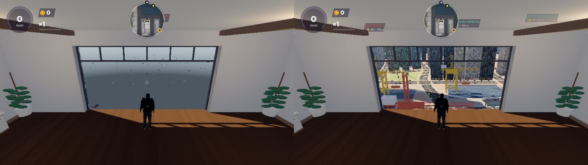

## 2. Five homes, five places

Before: one plan for all five homes (bedroom/hall/bath split, the same
kitchen strip, the same triptych), recoloured. Left column: at the window;
middle: across the room; right: towards the back.

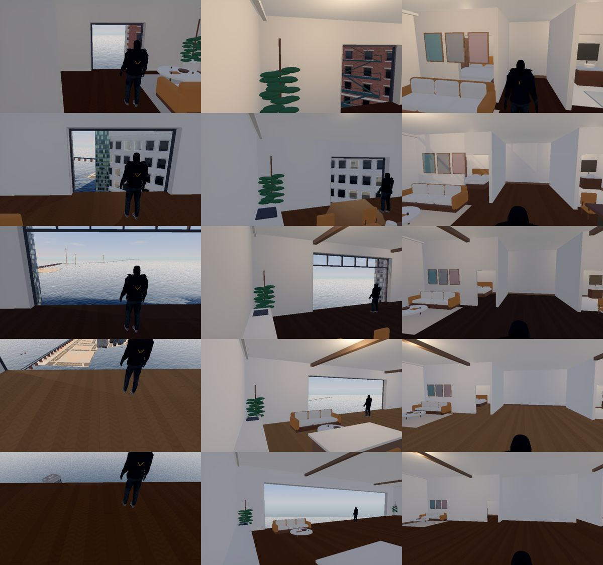

After: Quay Studio, City Apartment, High-Rise Loft, Sky Apartment,
Penthouse (top to bottom).

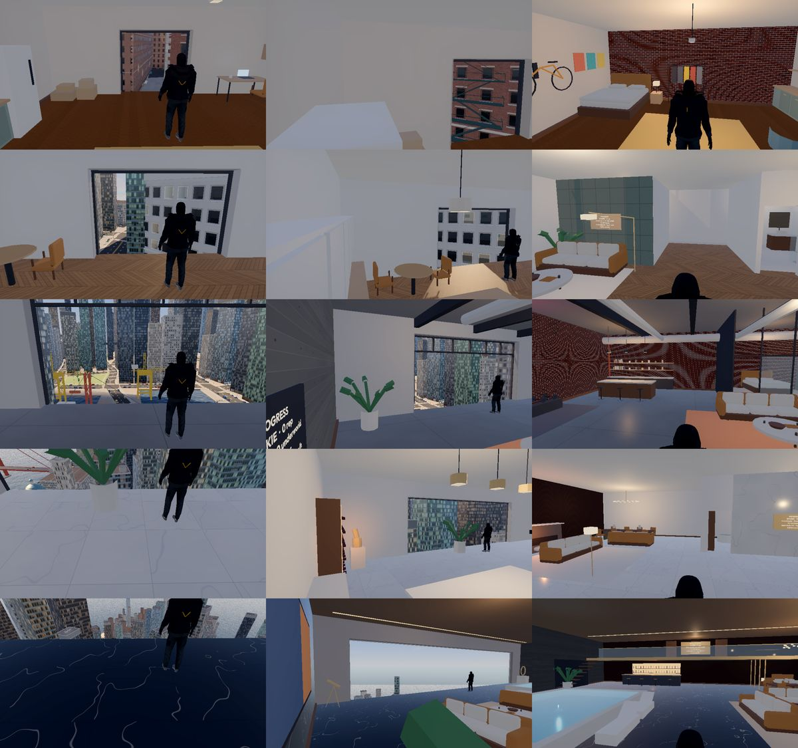

In game (real HUD, wake-up camera): the Sky Apartment and the Penthouse.

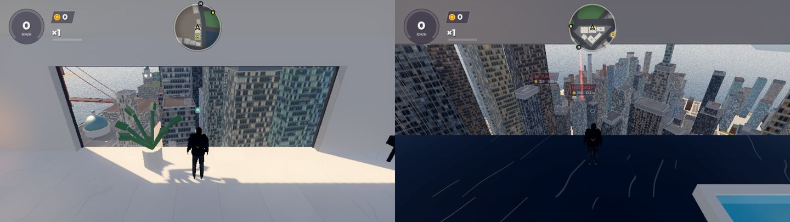

The Homes screen shows each home's character and its rested bonus:

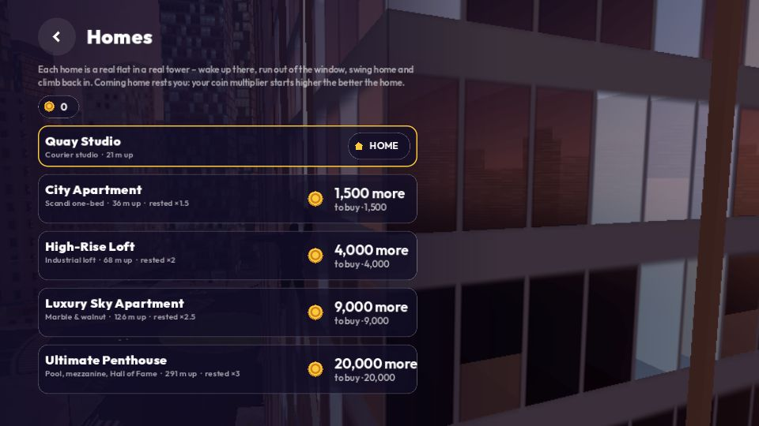

## 3. Contracts

Offers stand on rooftops as columns of light with labels (left); the Job
Board in the pause menu (right).

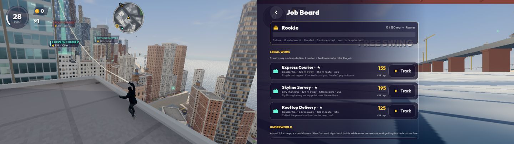

On the job: an underworld Getaway (clock, heat bar, drone count, route
pointer) and a Gondola Rescue.

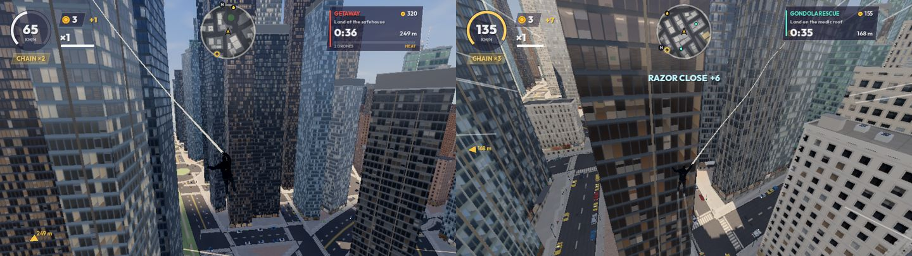

## 4. Light

Same seed, same frames: main (left) and this branch (right). Less milky
haze, shade reads cool rather than grey, sun/shade contrast is back.

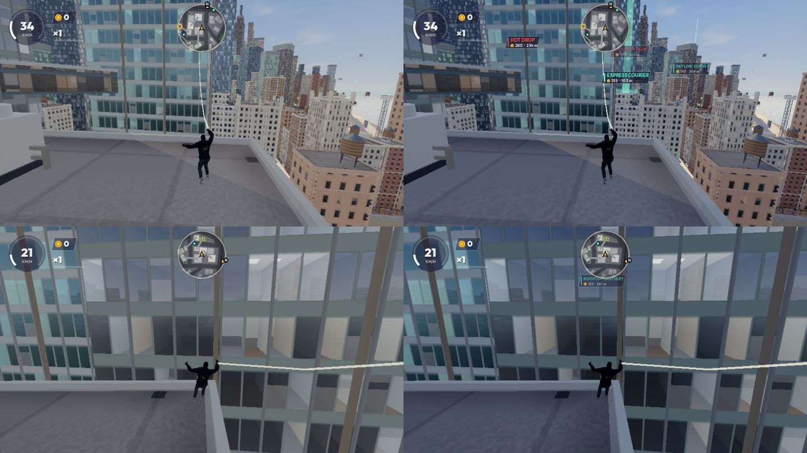

Title shots on the new grade (golden hour, canyon, momentum):

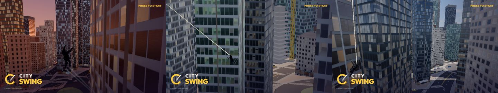

## What I looked for and what's left

- Fixed after review: drone beam washing the screen when it hit the camera
  (near fade + narrower cone), toast hidden under the minimap, brick moiré
  at distance, stone veining reading as cracks, Homes page clipped by a
  long unwrapped intro, heat label crowding the clock, job labels
  cluttering the screen at speed (max 3, fade above ~60 km/h).
- Still visible: the hero reads as a dark silhouette against bright sky
  (the Courier's charcoal outfit; character shaders belong to the other
  agent's work and were not touched); building window grids still repeat.

## 5. World pass (2026-11-02)

The bay: before, the island sat on an endless flat sea; now a horseshoe of
hills and snow-capped western mountains rings the bay (open sea east).

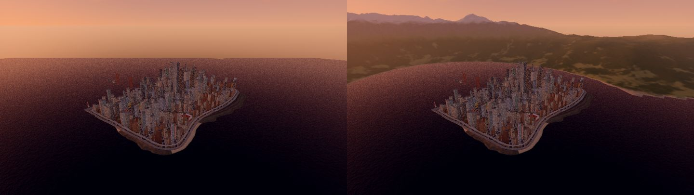

Map, before / after: Westbank (left) is no longer a rectangle (bays, a
cape, an inlet), the Cross-City Line runs north–south through the middle
of the island, and the stadium is a bigger bowl on its own plaza.

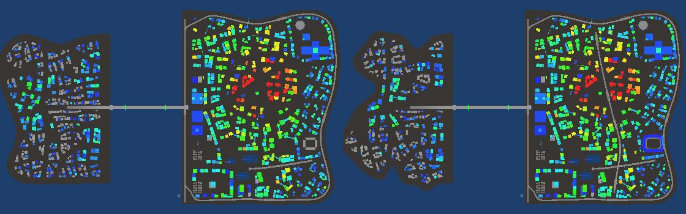

The stadium, before / after (bowl, ring roof, cable-stayed masts, fins).

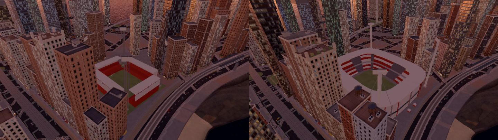

Westbank from the bridge with the mountains behind; pylons and conductors
along the western foothills.

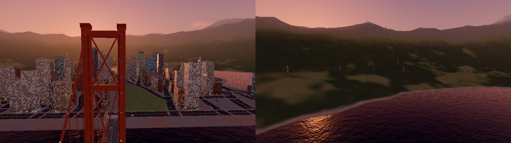

The Cross-City viaduct down the CBD boulevard; the skyline with spires,
masts and helipads on the supertall towers.

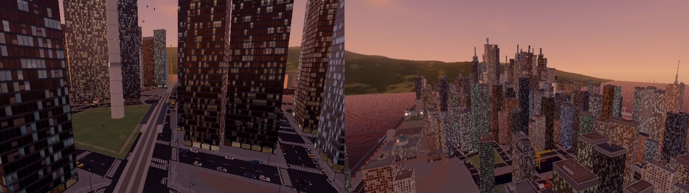

## 6. Homes pass: bigger rooms, indoor camera (2026-11-02)

Every home is bigger (Studio 12×11 m, Apartment 16×14, Loft 20×16 with a
6 m ceiling, Sky 24×18, Penthouse 26×20 with a 7 m ceiling) and redrawn
for its size. Left: the whole room; middle: waking up (real HUD and
camera); right: the follow camera while walking the room
(`tools/home_cam_probe.gd`). Top to bottom: Quay Studio, City Apartment,
High-Rise Loft, Sky Apartment, Penthouse (on the mezzanine).

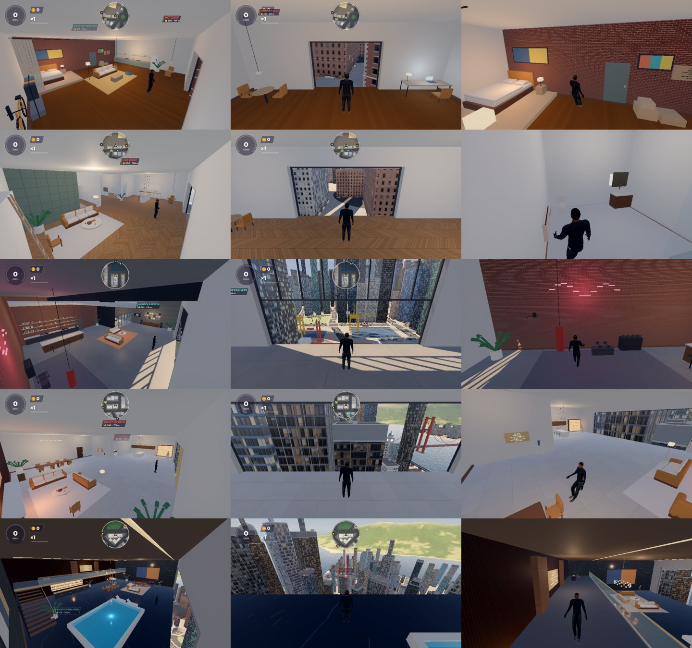

Camera on the probe's routes at 60 fps, old camera → new: hero hidden
behind walls 25 → 1 frames of 353 (apartment), 67 → 0 of 276 (sky),
32 → 0 of 594 (penthouse); lens out of the apartment 6 → 0.
